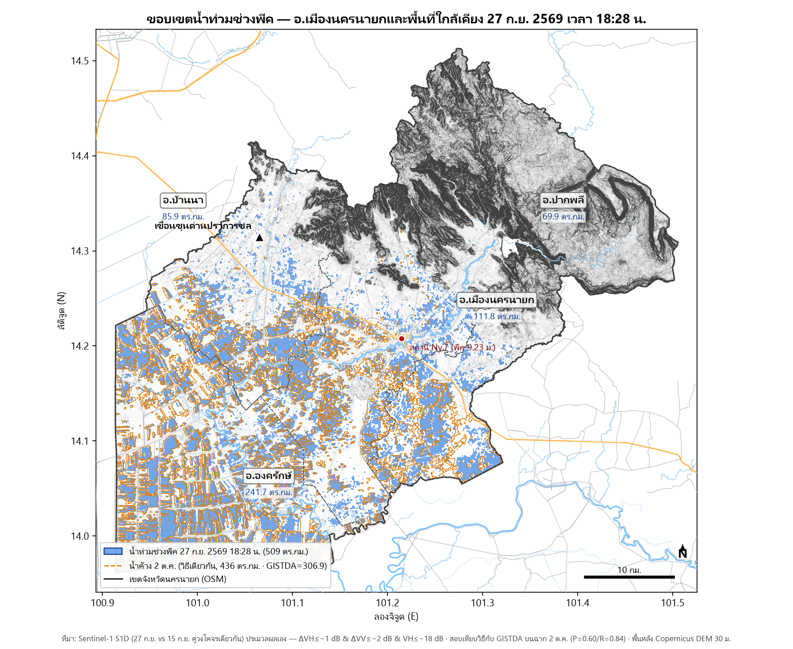

# การสอบสวนเชิงหลักฐานด้านอุทกวิทยาและการบริหารจัดการน้ำ
### นครนายก 2569 · 6 ลุ่มน้ำทั่วประเทศ & เปรียบเทียบปี 2554 · โครงการคลองเจ้าพระยา 2

> 📖 **ศูนย์รวมรายงานออนไลน์:** **[tkittich.github.io/nnyflood](https://tkittich.github.io/nnyflood/)**
>
> การวิเคราะห์เชิงหลักฐานด้านอุทกวิทยาและการบริหารจัดการน้ำด้วยข้อมูลเปิดเผยสาธารณะ + การประมวลผลดาวเทียม Sentinel-1
> ครอบคลุม 3 เสาหลักการศึกษา รวม 6 รายงานฉบับส่งมอบ (single-file HTML เปิดอ่านออฟไลน์ได้ถาวร)

---

## 3 เสาหลักของการศึกษานี้

โปรเจกต์นี้เริ่มต้นจากการสอบสวนเชิงลึกของเหตุการณ์น้ำท่วมนครนายก ปลายกันยายน 2569 ก่อนจะขยายระเบียบวิธีวิจัยเดียวกันออกสู่ระดับประเทศ เพื่อตอบคำถามเชิงระบบของการบริหารจัดการน้ำและโครงการขนาดใหญ่ของประเทศไทย:

| เสาหลัก | ขอบเขตการศึกษา | ประเด็นใจกลางที่ตอบ | รายงานที่เกี่ยวข้อง |
|---|---|---|---|
| **เสาหลักที่ 1 (เป้าหมาย 1–5)** | เหตุการณ์น้ำท่วมนครนายก (ปลาย ก.ย. 2569) | ฝนตกหนักหรือการระบายน้ำของเขื่อนขุนด่านฯ เป็นสาเหตุหลัก? ถ้าย้อนเวลากลับไปบริหารจัดการต่างออกไปจะลดน้ำท่วมได้เท่าไร? สัญญาณเตือนภัยล่วงหน้าทำงานได้จริงไหม? | [รายงานที่ 1 (ประชาชน)](report/น้ำท่วมนครนายก2569_ประชาชน.html) · [รายงานที่ 2 (วิชาการ)](report/น้ำท่วมนครนายก2569_วิชาการ.html) |
| **เสาหลักที่ 2 (เป้าหมาย 6)** | 6 ลุ่มน้ำหลักทั่วประเทศ & เทียบเคียงมหาอุทกภัย 2554 | พฤติกรรมฝน น้ำหลาก และการเก็บน้ำเหนือเส้นควบคุมบน (URC) ของเขื่อนหลักทั่วประเทศเหมือนหรือต่างจากปี 2554 อย่างไร? คอขวดการระบายน้ำอยู่ตรงไหน? | [รายงานที่ 3 (6 ลุ่มน้ำ)](report/ระลอกปลายกย2569.html) · [รายงานที่ 4 (เทียบ 2554)](report/ชุดเทียบมาตรฐาน2554.html) |
| **เสาหลักที่ 3 (เป้าหมาย 7)** | โครงการคลองระบายน้ำหลากเจ้าพระยา 2 (ชัยนาท–ป่าสัก–อ่าวไทย) | โครงการเมกะโปรเจกต์ 1.65 แสนล้านบาทจะช่วยแก้ปัญหาน้ำท่วมหรือสร้างความเสี่ยงใหม่ต่อระบบคลองรังสิต-องครักษ์-นครนายก? คันคลองสูง 3.2–4.8 ม. ส่งผลต่อชุมชนอย่างไร? | [รายงานที่ 7 (ประชาชน)](report/คลองเจ้าพระยา2_ประชาชน.html) · [รายงานที่ 8 (วิชาการ)](report/คลองเจ้าพระยา2_วิชาการ.html) |

---

## สรุปสาระสำคัญ (TL;DR)

- **เสาหลักที่ 1 — นครนายก 2569:** ตัวจุดชนวนคือ**ฝน 18 วัน 1,058–1,416 มม. บนลุ่มน้ำที่อิ่มตัวแล้ว** — แม้เขื่อนขุนด่านฯ ไม่ปล่อยน้ำเลย น้ำก็ท่วมเมืองคืน 26 ก.ย. · แต่การปล่อยน้ำช่วงน้ำสูงสุดคือตัว**ยืดเวลาท่วมขัง**: น้ำปล่อยเขื่อนคิดเป็น **60% ของน้ำที่ไหลผ่านเมืองช่วงน้ำขัง** และถ้า "หยุดปล่อยผ่านช่วงน้ำสูงสุดเมือง 48–72 ชม." น้ำล้นตลิ่งลดได้ **55–93%** · ทุกตัวเลขทำซ้ำได้จากข้อมูลสาธารณะล้วน (Sentinel-1 SAR · โทรมาตร กช. · Copernicus DEM)
- **เสาหลักที่ 2 — 6 ลุ่มน้ำทั่วประเทศ & เทียบปี 2554:** ฝนปลาย ก.ย. 2569 กระจายตัวหลายลุ่มน้ำ (67 จาก 199 สถานีตรวจวัด มีฝน 7 วันติดอันดับท็อป 3 ในรอบ 46 ปี) · เขื่อนป่าสักชลสิทธิ์เก็บน้ำเกินเส้นควบคุมบน (URC) เป็นประจำ (16 จาก 22 ปีช่วงกลางฤดูฝน, 20 จาก 22 ปีหากนับทั้งปี) ขณะที่เขื่อนหลักในลุ่มน้ำแม่กลองแทบไม่เกินเส้นควบคุม · ภาพสะท้อนน้ำท่วมสูงสุดจากดาวเทียม Sentinel-1 ครอบคลุม 6 ลุ่มน้ำ (ปิง-เจ้าพระยา 2,263.6 ตร.กม., บางปะกง-ปราจีนบุรี 1,281.6 ตร.กม., เจ้าพระยาตอนล่าง-กทม. 1,104 ตร.กม. หลังตัดน้ำทะเล, ป่าสัก 521 ตร.กม., ท่าจีน 160.4 ตร.กม., แม่กลอง 73 ตร.กม.)
- **เสาหลักที่ 3 — โครงการคลองเจ้าพระยา 2:** โครงการระบายน้ำหลาก 900–1,000 ลบ.ม./วินาที วงเงิน 165,000 ล้านบาท (ปรับปรุงคลองเดิม 134.4 กม. + คลองขุดใหม่ 135.7 กม.) · ช่วงป่าสัก–อ่าวไทยเป็น "คลองลอย" คันคลองสูง 3.2–4.8 ม. ตัดขวางระบบคลองชลประทานเดิม มีอาคารเชื่อมคลอง 34 จุดและอาคารบังคับน้ำรวม 99 แห่ง · ต้องจับตาการระบายน้ำของพื้นที่สองฝั่งคลองและความเสี่ยงดินเปรี้ยวจัดอย่างใกล้ชิด

**English Summary:** An open-data hydrological and water management forensic investigation across 3 core pillars: (1) Nakhon Nayok 2026 flood event, showing rainfall (1,058–1,416 mm) was the trigger while dam release made up 60% of ponding volume, with 55–93% overbank reduction possible via 48–72 h hold; (2) National 6-basin flood wave & 2554 benchmark across 2,315 watergates, 199 rain gauges, and multi-basin Sentinel-1 SAR flood mapping; and (3) Chao Phraya 2 floodway mega-canal project (165,000 million THB, 226.7 km, 3.2–4.8 m embankment heights crossing existing canal networks). All reports are self-contained single-file HTML; scripts, evidence, and test suites are in this repository.



*แผนที่น้ำท่วมสูงสุด เย็น 27 ก.ย. 2569 — 452 ตร.กม. จากการประมวลผล Sentinel-1 เอง · ที่ราบโทนครีม ภูเขาโทนน้ำตาล · ถนนและแม่น้ำจาก OpenStreetMap · พื้นที่น้ำท่วมสีน้ำเงิน*

---

## รายงานทั้งหมดในโปรเจกต์นี้

รายงานทุกฉบับจัดทำเป็น "ไฟล์เดียวจบ" (single-file HTML) ฝังภาพ กราฟ และแผนที่ในตัวไฟล์ สามารถดาวน์โหลดไปเปิดอ่านแบบออฟไลน์ได้ถาวรโดยไม่ต้องต่ออินเทอร์เน็ต

| ฉบับ | ลุ่มน้ำ / โครงการ | กลุ่มเป้าหมาย | สาระสำคัญ | ลิงก์อ่านออนไลน์ | ไฟล์เดียวจบ |
|---|---|---|---|---|---|
| **รายงานที่ 1** | ลุ่มน้ำนครนายก (เป้าหมาย 1–5) | ประชาชนทั่วไป / ชุมชน / สื่อมวลชน | เล่าเหตุการณ์ตามลำดับเวลา ถาม–ตอบ 15 ข้อ แผนที่น้ำท่วมเคลื่อนไหว ไฮโดรกราฟแยกส่วนสาเหตุ และแบบจำลองทำนายระดับน้ำ Ny.7 | [อ่านออนไลน์](https://tkittich.github.io/nnyflood/report/น้ำท่วมนครนายก2569_ประชาชน.html) | [HTML](report/น้ำท่วมนครนายก2569_ประชาชน.html) |
| **รายงานที่ 2** | ลุ่มน้ำนครนายก (เป้าหมาย 1–5) | นักวิชาการ / วิศวกร / นักวิเคราะห์ | วิธีวิทยาทางอุทกวิทยา สมการ พารามิเตอร์จำลองอ่างเก็บน้ำ การตรวจไขว้ ข้อจำกัด และขั้นตอนทำซ้ำทุกตัวเลข | [อ่านออนไลน์](https://tkittich.github.io/nnyflood/report/น้ำท่วมนครนายก2569_วิชาการ.html) | [HTML](report/น้ำท่วมนครนายก2569_วิชาการ.html) |
| **รายงานที่ 3** | 6 ลุ่มน้ำทั่วประเทศ (เป้าหมาย 6) | ประชาชน / ผู้บริหารนโยบาย | ขยายผลสู่ 6 ลุ่มน้ำหลัก: นครสวรรค์ ป่าสัก ท่าจีน แม่กลอง ปราจีนบุรี–บางปะกง และ กทม.–เจ้าพระยาตอนล่าง โทรมาตรแม่น้ำ + ปตร. 2,315 แห่ง + Sentinel-1 | [อ่านออนไลน์](https://tkittich.github.io/nnyflood/report/ระลอกปลายกย2569.html) | [HTML](report/ระลอกปลายกย2569.html) |
| **รายงานที่ 4** | เขื่อนทั่วประเทศ (เป้าหมาย 6) | นักวิชาการ / ผู้บริหารน้ำ | ชุดเทียบมาตรฐานปี 2554 เทียบ 2569: พฤติกรรมการเก็บน้ำเหนือเส้นควบคุมบน (URC) รายเขื่อน และสถิติฝนสะสมข้ามปี | [อ่านออนไลน์](https://tkittich.github.io/nnyflood/report/ชุดเทียบมาตรฐาน2554.html) | [HTML](report/ชุดเทียบมาตรฐาน2554.html) |
| **รายงานที่ 7** | คลองเจ้าพระยา 2 (เป้าหมาย 7) | ชุมชน / ท้องถิ่น / ประชาชน | โครงการคลองระบายน้ำหลากชัยนาท–ป่าสัก–อ่าวไทย: ถาม–ตอบ 23 ข้อ ทำไมคันคลองสูง 3.2–4.8 ม. ผลกระทบต่อองครักษ์และนครนายก | [อ่านออนไลน์](https://tkittich.github.io/nnyflood/report/คลองเจ้าพระยา2_ประชาชน.html) | [HTML](report/คลองเจ้าพระยา2_ประชาชน.html) |
| **รายงานที่ 8** | คลองเจ้าพระยา 2 (เป้าหมาย 7) | วิศวกร / นักผังเมือง / นโยบาย | ตัวแปรออกแบบทางชลศาสตร์ อาคารบังคับน้ำ 99 แห่ง จุดตัดคลองเดิม 34 แห่ง รายงานผลกระทบสิ่งแวดล้อม (EIA 2561–2569) และดินกรดกำมะถัน | [อ่านออนไลน์](https://tkittich.github.io/nnyflood/report/คลองเจ้าพระยา2_วิชาการ.html) | [HTML](report/คลองเจ้าพระยา2_วิชาการ.html) |

---

## ข้อค้นพบหลักแยกตามเสาหลักการศึกษา

### เสาหลักที่ 1: การสอบสวนน้ำท่วมนครนายก ปลายกันยายน 2569 (รายงานที่ 1 และ 2)

1. **ฝนคือตัวจุดชนวน เขื่อนคือตัวยืดเวลา** — ฝน 18 วัน 1,058–1,416 มม. ตกเชิงเขาและที่ราบ (ไม่ใช่เขาใหญ่) บนลุ่มน้ำที่อิ่มตัวแล้วตั้งแต่ 19 ก.ย. แม้เขื่อนกักน้ำได้มากที่สุด ระดับน้ำเมืองก็ข้ามเกณฑ์เริ่มท่วมคืน 26 ก.ย. แล้ว (ฝนอย่างเดียวให้น้ำสูงสุด 8.75 > 8.45 ม.) · แต่น้ำปล่อยเขื่อนคิดเป็น **60% ของน้ำที่ไหลผ่านเมืองช่วงน้ำขัง** (12% ช่วงน้ำขึ้น) และทำให้ท่วมขังยาวถึง 65 ชม. — วัดจากโทรมาตรทุก 15 นาที
2. **ปัจจัยชี้ขาดของการบริหารคือ "หน้าต่างเวลา" ไม่ใช่ "ปริมาตร"** — ทำตามเส้นควบคุมบน (URC) = น้ำล้น −55% ท่วม 65→18 ชม. · ระบายน้ำออกจากอ่างล่วงหน้าเพียง 13 ลลบ.ม. พร้อมหยุดปล่อยผ่านช่วงน้ำสูงสุดเมือง = **−93% ท่วมแค่ข้ามคืนเดียว** — ผลเทียบเท่าการระบายออกจากอ่างมากถึง 84 ลลบ.ม. เพราะสิ่งที่ต่างจริง ๆ คือ "หยุดปล่อย 26–28 ก.ย."
3. **พื้นที่น้ำท่วมสูงสุด 452 ตร.กม. วัดได้เองจากดาวเทียมสาธารณะ** — ประมวลผล Sentinel-1 17 ฉาก ครอบทั้งเหตุการณ์ (9 ก.ย.–2 ต.ค.) ด้วยกฎการตรวจจับที่สอบเทียบกับผลิตภัณฑ์ทางการ (F1 0.70 บนฉากเดียวกัน) — ภาพรายวันช่วงน้ำสูงสุดไม่มีผู้ใดมีมาก่อน
4. **สัญญาณเตือนล่วงหน้า 4 วันมีอยู่จริงในข้อมูลสาธารณะ** — Google Flood Hub และโพสต์พยากรณ์เอกชนระบุอุทกภัยลุ่มนครนายกล่วงหน้าตั้งแต่ 22 ก.ย. · และโมเดลเส้นตรงจากโทรมาตร 5 ปีทำนายระดับน้ำ 24 ชม. ล่วงหน้าได้ RMSE 0.78 ม. (ทั้งช่วงทดสอบ; เฉพาะช่วงเหตุการณ์ 1.18 ม. โดยในช่วงทดสอบนี้วิธีพื้นฐาน "พรุ่งนี้เท่าวันนี้" ได้ 0.71 ม. ขณะที่สูตรเส้นตรงชนะวิธีพื้นฐานในการทดสอบย้อนหลังหลายฤดู)
5. **บทเรียนวิธีวิทยา** — (ก) การตรวจจับน้ำด้วยดาวเทียมอัตโนมัติมีข้อจำกัดชัดเจนช่วงฝนหนัก/น้ำไหลแรง: ในฉาก Sentinel-1 เช้าวันน้ำสูงสุด การประมวลผลอิสระเห็น 51.5 ตร.กม. ขณะที่ผลิตภัณฑ์สาธารณะรายงาน 8.3 ตร.กม. จึงไม่ควรตัดสินสถานการณ์จากผลิตภัณฑ์เดียว · (ข) เหตุการณ์สุดขั้วทำให้โมเดลแบบตัดสินใจ (GBDT) ใช้งานได้จำกัด สูตรเส้นตรงให้ผลเสถียรกว่าเพราะค่าน้ำสูงสุดเกินช่วงฝึก · (ค) นิยาม "ระดับล้นตลิ่ง" ต่างกันได้ ~1.4 ม.: น้ำสูงสุด 7.64 ม.รทก. ไม่ล้นสันตลิ่งจริง (8.21 ม.รทก.) แต่ท่วมที่ราบริมซึ่งต่ำกว่าสันตลิ่ง ตามหน้าตัดจริงของ กช.

### เสาหลักที่ 2: การวิเคราะห์ 6 ลุ่มน้ำทั่วประเทศ & เทียบปี 2554 (รายงานที่ 3 และ 4)

1. **การกระจายตัวของฝนระดับชาติ** — ฝนระลอกปลาย ก.ย. 2569 ไม่ได้กระจุกตัวเฉพาะลุ่มน้ำภาคเหนือ แต่กระจายตัวรุนแรงใน 6 ลุ่มน้ำหลัก โดยมี 67 จาก 199 สถานีตรวจวัด (32 จาก 99 ช่องกริด) ที่มีปริมาณฝนสะสม 7 วันติด 3 อันดับแรกในรอบ 46 ปี
2. **พฤติกรรมเขื่อนเหนือเส้นควบคุมบน (URC)** — เขื่อนป่าสักชลสิทธิ์เก็บน้ำเกินเส้นควบคุมบน (URC) เป็นประจำ (16 จาก 22 ปีช่วงกลางฤดูฝน, 20 จาก 22 ปีหากนับทั้งปี) สะท้อนความกดดันของการบริหารน้ำในพื้นที่ลุ่มน้ำตอนกลาง ขณะที่เขื่อนหลักในลุ่มน้ำแม่กลองแทบไม่เคยเกินเส้นควบคุมเลย
3. **พื้นที่น้ำท่วมสูงสุดข้ามลุ่มน้ำจาก Sentinel-1** — วัดพื้นที่น้ำท่วมสูงสุดในระลอกปลาย ก.ย. 2569 ครอบคลุมลุ่มน้ำสำคัญ: ปิง-เจ้าพระยา 2,263.6 ตร.กม., บางปะกง-ปราจีนบุรี 1,281.6 ตร.กม., เจ้าพระยาตอนล่าง-กทม. 1,104 ตร.กม. (หลังตัดพื้นที่น้ำทะเล), ป่าสัก 521 ตร.กม., ท่าจีน 160.4 ตร.กม., และแม่กลอง 73 ตร.กม.

### เสาหลักที่ 3: โครงการคลองระบายน้ำหลากเจ้าพระยา 2 (รายงานที่ 7 และ 8)

1. **ขอบเขตโครงการและมิติทางวิศวกรรม** — โครงการคลองระบายน้ำหลากชัยนาท–ป่าสัก–อ่าวไทย วงเงิน 165,000 ล้านบาท (ปีงบประมาณ 2570–2577) ประกอบด้วยการปรับปรุงคลองชัยนาท–ป่าสักเดิม (134.4 กม., รองรับน้ำ 930 ลบ.ม./วินาที) และการขุดคลองระบายน้ำหลากใหม่ช่วงป่าสัก–อ่าวไทย (135.7 กม., รองรับน้ำ 600 ลบ.ม./วินาที) พร้อมความจุเก็บกักน้ำในคลองรวม 155.8 ล้าน ลบ.ม.
2. **สภาพ "คลองลอย" และจุดตัดระบบชลประทานเดิม** — คลองขุดใหม่ช่วงป่าสัก–อ่าวไทยส่วนใหญ่มีระดับน้ำสูงสุดออกแบบสูงกว่าผิวดินเดิม 1–3.3 ม. และมีคันคลองสูงถึง 3.2–4.8 ม. ตัดขวางระบบคลองชลประทานและคลองธรรมชาติเดิม โดยมีอาคารเชื่อมคลองแบบท่อลอดและไซฟอน 34 จุด (ตาม EIA) และอาคารบังคับน้ำรวม 99 แห่ง
3. **ความเสี่ยงดินเปรี้ยวจัดและการระบายน้ำสองฝั่งคลอง** — แนวคลองตัดผ่านพื้นที่ดินกรดกำมะถันจัดในเขตลุ่มน้ำนครนายก/บางปะกง/รังสิต ซึ่งต้องการการบริหารจัดการคุณภาพน้ำขุดลอกอย่างรัดกุม ขณะที่คันคลองยกสูงทำหน้าที่เสมือนแนวกั้นน้ำหลาก จึงจำเป็นต้องพึ่งพาระบบคูระบายน้ำข้างคลอง (side drain) และไซฟอนที่มีประสิทธิภาพเพื่อไม่ให้กระทบพื้นที่ชุมชนโดยรอบ

---

## โครงสร้าง repository

```
START_HERE.md        ← ทางเข้าหลัก: ลำดับการอ่าน + คำสั่งทำซ้ำตัวเลขหัวใจ
report/              ← รายงานส่งมอบ 6 ฉบับ (ไฟล์ HTML เดียวจบ)
docs/                ← ระเบียบวิธีวิจัย + ข้อตกลงรายงาน + พจนานุกรมข้อมูล + แหล่งข้อมูล
analysis/            ← สคริปต์ประมวลผล + ผลสังเคราะห์ (CSV/JSON/PNG/MD)
data/                ← ข้อมูลหลักฐานพร้อม manifest และ SHA-256 ตรวจสอบได้
tests/               ← ชุดทดสอบอัตโนมัติ 104 ตัว (ป้องกัน regression)
index.html           ← หน้ารวมลิงก์รายงาน (เผยแพร่ผ่าน GitHub Pages)
```

---

## การทำซ้ำ (Reproduce)

ดูรายละเอียดขั้นตอนทั้งหมดใน `START_HERE.md` §4 — ตัวเลขหัวใจทุกตัวสามารถทำซ้ำได้ด้วยข้อมูลเปิดและคำสั่งบรรทัดเดียว:

```bash
pip install -r requirements.txt
python -m pytest tests/ -q                       # ชุดทดสอบอัตโนมัติ 104 ตัวผ่านทั้งหมด
python analysis/goal4_model_v1.py                # แบบจำลองทำนายระดับน้ำหลัก
python analysis/verify_data_integrity.py --quick # ตรวจสอบแฮช SHA-256 ข้อมูลต้นฉบับ
```

การควบคุมคุณภาพของโปรเจกต์:
- ชุดทดสอบอัตโนมัติ 104 รายการผ่านทั้งหมด (ครอบคลุมความสอดคล้องของตัวเลข canonical, โครงสร้างรายงาน, และการประมวลผล)
- ตรวจสอบความถูกต้องของไฟล์ข้อมูลต้นฉบับด้วยแฮช SHA-256 ผ่านทั้งหมด (MISMATCH 0)
- ตัวเลขสำคัญทุกตัวมีการตรวจไขว้ข้ามแหล่งข้อมูลอิสระอย่างน้อย 2 แหล่ง

---

## ข้อจำกัดและการอ้างอิง

- **รายงานทั้งหมดจัดทำร่วมกับระบบปัญญาประดิษฐ์ (AI-assisted)** — ควรผ่านการตรวจทานโดยผู้เชี่ยวชาญด้านอุทกวิทยาหรือวิศวกรรมชลศาสตร์ก่อนนำไปใช้ประกอบการตัดสินใจเชิงกฎหมายหรือนโยบาย
- ข้อมูลดิบบางชุดที่มีขนาดใหญ่มาก (ฉากดาวเทียม Sentinel-1 ภาพถ่ายดาวเทียมความละเอียดสูง ไฟล์ DEM) ถูกเก็บอยู่นอก git เพื่อสุขลักษณะของ repository โดยมีบันทึก manifest และ SHA-256 ให้ตรวจสอบความสมบูรณ์
- แบบจำลองสถานการณ์และการประมาณการทางอุทกวิทยามีระดับความไม่แน่นอนตามที่ระบุไว้ในเอกสารระเบียบวิธีวิจัย (rating curve ±18–20%, lag time ±6 ชม.)
- ข้อมูลและภาพจากบุคคลภายนอก (ภาพประชาชน, ข้อมูลผังน้ำ, แผนที่ GIS) นำมาใช้เพื่อการศึกษา อ้างอิงทางวิชาการ และประโยชน์สาธารณะ
- ข้อมูล Sentinel-1/Copernicus: Contains modified Copernicus Sentinel data (2026)/ESA · ข้อมูลโทรมาตรและผังน้ำจาก กรมชลประทาน / สทนช. / GISTDA (ทางการ)

---

## สัญญาอนุญาต · การอ้างอิง · การติดต่อ

- **โค้ด รายงาน และผลวิเคราะห์ของโปรเจกต์นี้:** เผยแพร่ภายใต้สัญญาอนุญาต [CC BY 4.0](LICENSE) — นำไปใช้ต่อและแบ่งปันได้เสรี โดยระบุแหล่งที่มา
- **ข้อมูลของบุคคลที่สาม** (OpenStreetMap, Copernicus/ESA, GISTDA, สทนช., กรมชลประทาน, NASA ฯลฯ) เป็นไปตามเงื่อนไขสัญญาอนุญาตของแต่ละแหล่ง — ดูรายละเอียดใน [THIRD_PARTY_NOTICES.md](THIRD_PARTY_NOTICES.md)
- **การอ้างอิงทางวิชาการ:**

  ```bibtex
  @misc{nnyflood2026,
    author       = {tkittich},
    title        = {การสอบสวนเชิงหลักฐานด้านอุทกวิทยาและการบริหารจัดการน้ำ: นครนายก 2569, 6 ลุ่มน้ำระดับชาติ และคลองเจ้าพระยา 2},
    year         = {2026},
    howpublished = {\url{https://github.com/tkittich/nnyflood}},
    note         = {รายงานจัดทำโดย AI ร่วมกับเจ้าของโปรเจกต์}
  }
  ```

- **ติดต่อ / ชี้ข้อผิดพลาด / เสนอแนะ:** เปิด [Issue บน GitHub](https://github.com/tkittich/nnyflood/issues) ได้เลย — บันทึกการตรวจทานกฎหมายก่อนเผยแพร่อยู่ที่ [docs/LEGAL_REVIEW.md](docs/LEGAL_REVIEW.md)

---

## เอกสารทั้งหมดในระบบ

| เอกสาร | คำอธิบายสาระสำคัญ |
|---|---|
| `START_HERE.md` | จุดเริ่มต้นโครงการ: ลำดับการอ่าน คำสั่งรันตัวเลข และบทเรียนที่พบ |
| `docs/REPORT_CONVENTIONS.md` | ข้อตกลงการจัดทำรายงาน: เอ็นจินโทเคน การผูก canonical ธีมสี WCAG และระเบียบการเขียน |
| `docs/METHODS.md` | มาตรฐานหลักฐาน `[F]/[I]/[O]` + วิธีประมวลผลดาวเทียม Sentinel-1 + โมเดลทำนาย |
| `docs/DATA_SOURCES.md` | ทะเบียนแหล่งข้อมูลทั้งหมด + สถานะการเข้าถึงและการจัดเก็บ |
| `docs/DATA_DICTIONARY.md` | นิยามตัวเลขทางการทุกตัว (canonical) + คำอธิบายฟิลด์ข้อมูล |
| `docs/ANALYSIS_PLAN.md` | แผนการวิเคราะห์และคำถามวิจัย A–E |
| `docs/ENVIRONMENT.md` | สภาพแวดล้อมทางเทคนิคและไลบรารี Python สำหรับการประมวลผล |
| `docs/LEGAL_REVIEW.md` | แนวทางความคุ้มครองข้อมูลและบันทึกการตรวจทานกฎหมายก่อนเผยแพร่ |
| `docs/reviews/` | บันทึกการตรวจทานอิสระ (DeepSeek R-01..R-13, Gemini, Qwen, Claude Sonnet, GLM) |
| `HANDOFF.md` | สถานะโครงการล่าสุด บันทึกงานค้าง และบทเรียนเทคนิคสำคัญ |
| `docs/GOAL6_PLAN.md` | แผนงานเป้าหมาย 6: การวิเคราะห์ 6 ลุ่มน้ำทั่วประเทศ ปตร. 2,315 แห่ง และชุดเทียบมาตรฐาน 2554 |
| `docs/GOAL7_PLAN.md` | แผนงานเป้าหมาย 7: โครงการคลองระบายน้ำหลากเจ้าพระยา 2 (ชัยนาท–ป่าสัก–อ่าวไทย) |
| `analysis/*_findings.md` | รายงานและบทวิเคราะห์เชิงลึกแยกตามแต่ละหัวข้อ |

---

*จัดทำเมื่อ ตุลาคม 2569 · รายงานจัดทำโดย AI ร่วมกับเจ้าของโปรเจกต์ — ตรวจสอบย้อนกลับได้ทุกตัวเลข*
