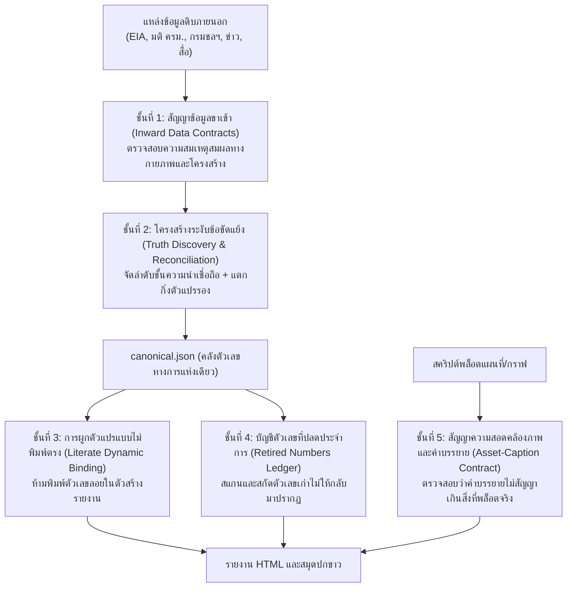

# ระบบการจัดการความสอดคล้องของข้อมูลและการระงับข้อขัดแย้งหลายแหล่ง (Data Consistency & Multi-Source Reconciliation Workflow)

> **สถานะ**: ประกาศใช้ 18 ต.ค. 2569 — ข้อกำหนดและแนวปฏิบัติด้านความถูกต้องของข้อมูลข้ามเสาหลัก รายงาน และเอกสาร
> **ผู้รับผิดชอบหลัก**: ทีมผู้วิเคราะห์ข้อมูล, สคริปต์คำนวณทางการ (Canonical Builders), และตัวสร้างรายงาน (Report Builders)
> **เป้าหมาย**: ขจัดปัญหาตัวเลขขัดแย้งกันเอง, การหยิบใช้ตัวเลขผิดรุ่น, การใช้ข้อความแก้ตัวแบบลอยตัว (Defensive Gaps), และการสัญญาข้อมูลเกินจริงในภาพประกอบ

---

## 1. บทนำและที่มาของปัญหา (Background & Root Cause Analysis)

ในการตรวจสอบรายงานข้ามฉบับ (รายงานที่ 1–4 และ 7–8) มักพบปัญหาความไม่สอดคล้องของข้อมูลใน 4 รูปแบบหลัก:

1. **การหยิบใช้ตัวเลขคนละรุ่นโดยไม่มีการสอบทาน (Version Fragmentation)**: เช่น ขนาดท้องคลองระบายน้ำหลากเจ้าพระยา 2 เอกสารร่างปี 2560 ระบุ 51.0 เมตร (สมมติลาดข้าง 1:3), รายงานผลกระทบสิ่งแวดล้อม (EIA) ปี 2569 ระบุหน้าตัด 504 ตร.ม. ลึก 7.0 เมตร (คำนวณได้ท้องคลอง 54.5 เมตร), และเอกสารบรรยายสรุปบางฉบับระบุ 48.0 เมตร เมื่อผู้เขียนต่างคนต่างหยิบตัวเลขคนละรุ่นมาใส่ ทำให้รายงานฉบับประชาชนและวิชาการให้ตัวเลขไม่ตรงกัน
2. **การคัดลอกตัวเลขที่ผิดพลาดต่อเนื่อง (Copycat Amplification)**: ตัวเลขบางค่า เช่น พื้นที่เวนคืน 16,305 ไร่ มาจากเอกสารศึกษาเบื้องต้นปี 2565 แต่ถูกนำไปคัดลอกต่อในข่าวและคำร้องของภาคประชาชน ทั้งที่ตัวเลขทางการในรายงาน EIA ปี 2569 แจกแจงแปลงที่ดินจริงไว้ที่ 16,288 ไร่
3. **พฤติกรรม Defensive Gap (การอ้างช่องว่างข้อมูลเพื่อแก้ตัว)**: การเขียนในรายงานว่า *"ความกว้างท้องคลองนี้ยังไม่มีที่มาอ้างอิง"* หรือ *"ปริมาตรรวม 55.4 ล้าน ลบ.ม. ที่ใช้ข้างต้น ไม่มีที่มาอ้างอิงในคลังข้อมูล"* ทั้งที่มีตัวเลขอยู่ในเอกสารทางการ หรือตัวเลข 55.4 นั้นเป็นตัวเลขที่คำนวณผิดเองแต่เดิม พฤติกรรมนี้ทำให้ผู้อ่านสับสนและลดทอนความน่าเชื่อถือของงานวิจัย
4. **ความไม่สอดคล้องระหว่างภาพประกอบและคำบรรยาย (Asset-Caption Decoupling)**: คำบรรยายใต้ภาพระบุว่า *"แผนที่ตำแหน่งอาคารบังคับน้ำ สถานีโทรมาตร และจุดตัดทางน้ำสำคัญ"* แต่บนแผนที่จริงแสดงเพียงแนวคลองและอาคารบังคับน้ำ โดยไม่มีจุดสถานีโทรมาตร

เพื่อแก้ปัญหานี้อย่างถาวร จึงกำหนดแนวปฏิบัตินี้ขึ้นโดยประยุกต์ใช้ทฤษฎีการค้นหาความจริง (Truth Discovery & Data Fusion), สัญญาข้อมูล (Data Contracts), ท่อประมวลผลวิเคราะห์ที่ทำซ้ำได้ (Reproducible Analytical Pipelines: RAP), และแบบจำลองการสืบค้นที่มา (W3C PROV-O)

---

## 2. สถาปัตยกรรมการป้องกัน 5 ชั้น (The 5-Layer Defense Model)



---

## 3. รายละเอียดข้อกำหนดแต่ละชั้น (Detailed Specifications)

### ชั้นที่ 1: สัญญาข้อมูลขาเข้า (Inward Data Contracts)
- **การตรวจสอบความสมเหตุสมผลทางกายภาพ (Physical Plausibility Bounds)**:
  - ก่อนที่สคริปต์สร้าง canonical จะบันทึกตัวเลขลง JSON ต้องมี assertion ตรวจสอบความสอดคล้องเชิงเรขาคณิตและชลศาสตร์เสมอ เช่น:
    - $\text{Total Storage} = \text{Active Storage} + \text{Dead Storage}$
    - $\text{Area} = (b + z \cdot d) \cdot d$ (ต้องสอดคล้องกับความกว้างท้องคลอง $b$, ลาดข้าง $z$, และความลึกน้ำ $d$)
    - $\text{Flow Velocity} = \frac{Q}{A}$ (ความเร็วการไหลต้องอยู่ในช่วงทางวิศวกรรมชลศาสตร์ 0.5–2.5 ม./วินาที)
- **การระบุที่มาของข้อมูลอย่างชัดเจน (Provenance Anchoring)**:
  - ห้ามป้อนตัวเลขแบบไม่มีที่มา (Bare Primitives) ทุกตัวเลขต้องมีชื่อเอกสาร, วันที่, เลขหน้า หรือตารางที่อ้างอิงกำกับไว้เสมอ

### ชั้นที่ 2: การระงับข้อขัดแย้งหลายแหล่ง (Truth Discovery & Reconciliation Protocol)
เมื่อมีตัวเลขที่ขัดแย้งกันจากหลายแหล่ง ให้ใช้ลำดับชั้นความน่าเชื่อถือ (Authoritative Precedence Hierarchy) ดังนี้:

1. **ระดับ A (หลักฐานวิศวกรรมทางการและกฎหมาย)**: รายงาน EIA ฉบับอนุมัติล่าสุด, แบบก่อสร้างรายละเอียด (Detailed Design), มติ ครม., ประกาศราชกิจจานุเบกษา
2. **ระดับ B (เอกสารราชการขั้นต้นและแบบร่าง)**: รายงานผลการศึกษาความเหมาะสม (Feasibility Study), เอกสารชี้แจงโครงการขั้นต้น
3. **ระดับ C (เอกสารสรุปการประชุมและสื่อสารสาธารณะ)**: สไลด์บรรยายสรุปของจังหวัด, ข่าวแถลงของหน่วยงาน
4. **ระดับ D (รายงานข่าวและข้อเรียกร้องภาคประชาชน)**: ข่าวหนังสือพิมพ์, คำร้อง/แถลงการณ์ภาคพลเมือง

**โครงสร้างระงับข้อขัดแย้งใน `canonical.json`**:
ให้บันทึกในหมวด `reconciled_parameters` โดยระบุ:
- ค่าทางการ (Canonical Value)
- เหตุผลในการตัดสินความขัดแย้ง (Resolution)
- รายการตัวเลขต่างแหล่ง (Variants) พร้อมระบุบริบท (Context) และสถานะ (`canonical`, `superseded`, `draft`, `discredited`, `active_variant`)

### ชั้นที่ 3: การผูกตัวแปรแบบมีชีวิต (Literate Dynamic Binding)
- **ห้ามพิมพ์ตัวเลขคงที่ (No Hardcoded Metric Literals)**: สคริปต์ใน `report/` ต้องอ่านตัวเลขจาก `canonical.json` หรือ `reconciled_parameters` เท่านั้น ห้ามพิมพ์ตัวเลขชี้วัดทางเทคนิคลงในข้อความ HTML โดยตรง
- **การอ้างอิงคำอธิบายข้อขัดแย้ง**: หากต้องพูดถึงตัวเลขหลายแหล่งในรายงาน ให้ใช้บล็อกสรุปข้อขัดแย้ง (`goal7_blocks.py` หรือเทียบเท่า) เพื่อให้ผู้อ่านเข้าใจว่าทำไมตัวเลขในข่าวจึงต่างจากตัวเลขทางการ

### ชั้นที่ 4: บัญชีตัวเลขที่ปลดประจำการ (W3C PROV Invalidation & Retired Ledger)
- เมื่อตัวเลขใดได้รับการพิสูจน์แล้วว่าเป็นค่าเก่าที่ถูกแทนที่ หรือเป็นค่าที่คำนวณผิดพลาด ให้เพิ่มค่านั้นลงใน `retired_values` พร้อมระบุเหตุผล
- มีตัวตรวจอัตโนมัติ (`test_data_consistency.py`) สแกนไฟล์รายงานและเอกสารทั้งหมด เพื่อให้แน่ใจว่าจะไม่มีการนำตัวเลขหรือข้อความแก้ตัวลอยเหล่านั้นกลับมาใช้อีก

### ชั้นที่ 5: สัญญาความสอดคล้องระหว่างภาพประกอบและคำบรรยาย (Asset-Caption Integrity Contract)
- คำบรรยายใต้ภาพต้องสอดคล้องกับองค์ประกอบที่มีอยู่จริงในภาพ
- ห้ามระบุคำว่า *"สถานีโทรมาตร"*, *"อาคารบังคับน้ำ"*, หรือ *"พื้นที่น้ำท่วมจำลอง"* ในคำบรรยาย หากแผนที่หรือภาพกราฟิกนั้นไม่ได้แสดงชั้นข้อมูลดังกล่าวจริง

---

## 4. กลไกการบังคับใช้ระบบอัตโนมัติ (Automated Enforcement Mechanisms)

ความสอดคล้องของข้อมูลไม่ได้ขึ้นอยู่กับความจำของผู้วิเคราะห์ แต่บังคับใช้ผ่าน 3 ประตูตรวจจับ:

### ประตูที่ 1: Git Pre-commit Hook (`tools/install_hooks.py`)
ทำงานทุกครั้งที่มีการรันคำสั่ง `git commit`:
1. ตรวจสอบสารบัญระบบ (`python catalog.py check`)
2. ตรวจสอบภาษาไทยและมาตรฐานเอกสาร (`pytest tests/test_thai_language_lint.py tests/test_standards_integrity.py -q`)
3. ตรวจสอบความสอดคล้องของข้อมูลและตัวเลขที่ปลดประจำการ (`pytest tests/test_data_consistency.py -q`)
*หากตรวจพบตัวเลขที่ปลดประจำการหรือสัญญาข้อมูลไม่ผ่าน ระบบจะระงับการ commit ทันที*

### ประตูที่ 2: เครื่องมือตรวจความสมบูรณ์แบบครบวงจร (`tools/verify_all.py`)
รวมการตรวจสอบ 5 ขั้นตอนหลัก:
- ขั้นตอนที่ 1: ตรวจสารบัญระบบและไฟล์อ้างอิง
- ขั้นตอนที่ 2: ตรวจความสมบูรณ์ของข้อมูลดิบ (SHA-256)
- ขั้นตอนที่ 3: ตรวจสอบมาตรฐานเอกสารและภาษาไทย
- ขั้นตอนที่ 4: ตรวจสอบความสอดคล้องของข้อมูล ตัวเลข และสัญญาภาพประกอบ (`test_data_consistency.py`)
- ขั้นตอนที่ 5: รันชุดทดสอบระบบทั้งหมด (`pytest tests/`)

### ประตูที่ 3: ระบบทดสอบถอยกลับ (Regression Test Suite)
- `tests/test_data_consistency.py`: ดูแลกฎระเบียบส่วนกลางของทั้งคลังข้อมูล
- `tests/test_goal6_consistency.py`: ดูแลตัวเลขและเส้นฐานของเสาที่ 2 (6 ลุ่มน้ำ)
- `tests/test_goal7_report.py`: ดูแลตัวเลข หน้าตัดชลศาสตร์ และการผูกโยงของเสาที่ 3 (คลองเจ้าพระยา 2)

---

## 5. แผนผังการดำเนินงานเมื่อพบข้อมูลขัดแย้ง (Step-by-Step Resolution Guide)

```text
[พบตัวเลขใหม่จากแหล่งข้อมูล]
         │
         ▼
[สืบค้นว่ามีตัวเลขนี้อยู่ใน canonical.json แล้วหรือไม่?]
   ├── มีแล้วและตรงกัน ──► ใช้งานผ่านตัวแปร canonical ตามปกติ
   └── ไม่ตรงกันหรือพบตัวเลขใหม่
         │
         ▼
[ตรวจสอบลำดับชั้นความน่าเชื่อถือ (Tier A/B/C/D)]
         │
         ▼
[ตรวจสอบความสมเหตุสมผลทางกายภาพและเรขาคณิต (Physical Check)]
         │
         ▼
[เพิ่ม/ปรับปรุงใน reconciled_parameters ในสคริปต์วิเคราะห์]
         │
         ▼
[บันทึกค่าเก่าลงใน retired_values พร้อมเหตุผล (ถ้าเป็นการยกเลิกค่าเดิม)]
         │
         ▼
[รันสคริปต์สร้าง canonical และตัวสร้างรายงาน]
         │
         ▼
[รัน python tools/verify_all.py เพื่อตรวจสอบความสมบูรณ์ 100%]
```
