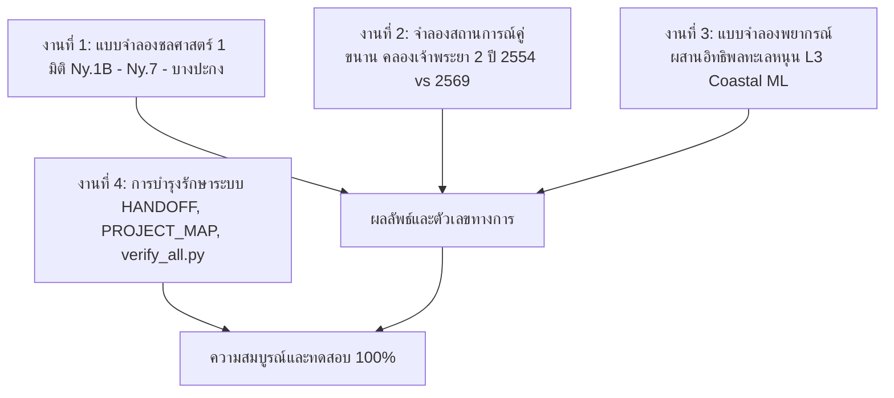

# แผนการดำเนินงาน: แบบจำลองชลศาสตร์ 1 มิติ, การจำลองคลองเจ้าพระยา 2, โมเดลพยากรณ์ผสานทะเลหนุน และการบำรุงรักษาระบบ
(Advanced Modeling & System Maintenance Implementation Plan)

> **วันที่จัดทำ**: 17 ตุลาคม 2569  
> **เป้าหมาย**: ยกระดับขีดความสามารถการวิเคราะห์ของคลังข้อมูลสู่ระดับวิศวกรรมชลศาสตร์และปัญญาประดิษฐ์เชิงฟิสิกส์ (Physics-Informed Modeling) พร้อมดูแลรักษาระบบให้สมบูรณ์พร้อมส่งมอบ

---

## 1. ขอบเขตงาน 4 ด้านหลัก

---

## 2. รายละเอียดขั้นตอนการปฏิบัติงาน

### งานที่ 1: แบบจำลองชลศาสตร์ 1 มิติ แม่น้ำนครนายก (1D Hydrodynamic River Routing)
- **ไฟล์สร้าง**: `analysis/hydraulic_1d_routing.py`
- **ข้อมูลนำเข้า**:
  - หน้าตัดสำรวจจริง 5 สถานีจาก `data/19_rid_cross_sections/` (Ny.1B 61 จุด, Ny.7 100+ จุด, Kgt.30 บางปะกง)
  - ไฮโดรกราฟการระบายน้ำเขื่อนขุนด่านฯ และระดับน้ำจริง 15 นาทีจาก `data/20_multistation_levels/`
- **ระเบียบวิธี**:
  - คำนวณคุณสมบัติทางเรขาคณิตจริงของร่องน้ำ: พื้นที่หน้าตัด $A(h)$, เส้นรอบรูปเปียก $P(h)$, รัศมีชลศาสตร์ $R(h)$, และความกว้างผิวน้ำ $B(h)$
  - จำลองการเคลื่อนตัวของมวลน้ำหลากแบบ 1D Unsteady Routing (Muskingum-Cunge / Diffusive Wave) คำนวณความเร็วคลื่นน้ำหลาก ($c = dQ/dA$)
  - คำนวณเวลาเดินทางจริง (Travel Time) จากเขื่อนขุนด่านฯ $\to$ Ny.1B $\to$ Ny.7
  - คำนวณอัตราน้ำบ่าล้นตลิ่งข้ามไปยังที่ราบน้ำท่วมถึง (Overbank Inundation Dynamics)
- **ผลลัพธ์**:
  - สรุปผล `analysis/hydraulic_1d_routing_summary.json`
  - กราฟรูปตัดผิวน้ำและไฮโดรกราฟ `report/assets/hydraulic_1d_nakhonnayok_profiles.png`

---

### งานที่ 2: จำลองสถานการณ์คู่ขนาน คลองระบายน้ำหลากเจ้าพระยา 2 (Counterfactual Simulation 2011 vs 2026)
- **ไฟล์สร้าง**: `analysis/goal7_counterfactual_simulation.py`
- **ข้อมูลนำเข้า**:
  - อนุกรมน้ำท่ารายวันมหาอุทกภัยปี 2554 และปี 2569 ที่จุด C.2 (นครสวรรค์), C.13 (เขื่อนเจ้าพระยา) และ S.26 (เขื่อนพระรามหก ป่าสัก)
  - พารามิเตอร์ออกแบบคลองเจ้าพระยา 2 จากรายงาน EIA (ความจุออกแบบ 600 ลบ.ม./วินาที และกรณีขยาย 1,000 ลบ.ม./วินาที)
- **ระเบียบวิธี**:
  - กฎการผันน้ำหลาก (Diversion Rule Curve): เริ่มเปิดรับน้ำหลากเมื่ออัตราการไหลในแม่น้ำสายหลักเกินความจุปลอดภัย ($> 2,000$ ลบ.ม./วิ)
  - คำนวณปริมาตรน้ำสะสมที่ถูกผันตรงลงสู่อ่าวไทย (MCM) ตลอดช่วง 90 วันน้ำท่วมใหญ่ปี 2554 และช่วง 20 วันปี 2569
  - ประเมินการลดระดับน้ำสูงสุด (Peak Stage Attenuation) ในลุ่มเจ้าพระยาตอนล่าง (อยุธยา-ปทุมธานี-กทม.)
- **ผลลัพธ์**:
  - `analysis/goal7/counterfactual_simulation_summary.json`
  - บันทึกลงในสัญญาตัวเลข `canonical.json` ของเป้าหมาย 7 และอัปเดตรายงานฉบับประชาชน/วิชาการของคลองเจ้าพระยา 2

---

### งานที่ 3: แบบจำลองพยากรณ์ผสานอิทธิพลน้ำทะเลหนุน (L3 Coastal-Coupled ML)
- **ไฟล์สร้าง**: `analysis/goal6_l3_coastal_model.py`
- **ข้อมูลนำเข้า**:
  - ระดับน้ำและปริมาณฝนลุ่มเจ้าพระยาตอนล่าง (`bkk_lower`)
  - ข้อมูลโทรมาตรน้ำทะเลหนุนราย 10 นาที 9 สถานีปากอ่าว (2012–2026) จาก `data/24_estuary_telemetry/`
  - แบบจำลองคลื่นทะเล SWAN 31 สถานี จาก `data/30_swan_wave_model/`
- **ระเบียบวิธี**:
  - นำเข้าตัวแปรขอบเขตท้ายน้ำ: ระดับน้ำทะเลหนุนตามเวลาจริง ($h_{tide}$), เฟสวัฏจักรน้ำขึ้น-น้ำลง (Tidal Phase), และความสูงคลื่นนัยสำคัญ ($H_s$)
  - เปรียบเทียบประสิทธิภาพแบบจำลอง ML (Linear vs GBDT vs Baseline Persistence) ที่ระยะทำนาย +6 ชม., +24 ชม., และ +48 ชม.
  - วัดค่าการลดลงของ RMSE เทียบกับแบบจำลองเดิมที่ใช้เฉพาะฝนและน้ำต้นน้ำ
- **ผลลัพธ์**:
  - `analysis/goal6/l3_coastal_summary.json`

---

### งานที่ 4: การบำรุงรักษาระบบ (System Maintenance & Catalog Sync)
- **สิ่งที่ต้องทำ**:
  1. สร้างสคริปต์ตรวจสอบรวมคำเดียว `tools/verify_all.py` (รันตรวจสอบแฮชข้อมูลดิบ + catalog check + pytest ครบทุกชุด)
  2. อัปเดต `HANDOFF.md` บันทึกความคืบหน้าการปลด hold รายงาน 1–2, การเพิ่มฐานข้อมูล 461 อ่าง และงานวิเคราะห์ใหม่
  3. อัปเดต `docs/PROJECT_MAP.md` และลงทะเบียนสคริปต์ใหม่ใน `catalog.py`
  4. รันชุดทดสอบทั้งหมด 100% และบันทึก git commit
