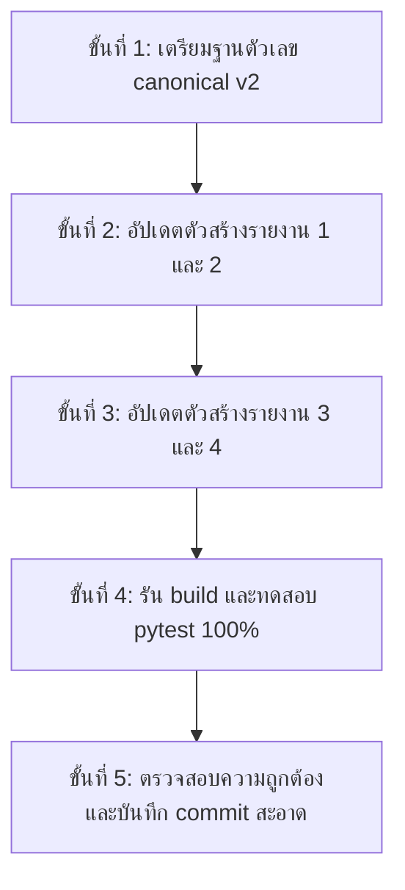

# แผนการปรับปรุงใหญ่ รายงานฉบับที่ 1–4 (Major Updates Plan for Reports 1–4)

> **สถานะ**: จัดทำ 17 ต.ค. 2569 ตามกติกาใน `AGENTS.md` ("รายงาน 1–2: hold ยกเลิกแล้ว — รอข้อตกลงฉบับสมบูรณ์แล้วจึงแก้ครั้งเดียว ห้ามแก้เป็นระลอก")  
> **วัตถุประสงค์**: รวบรวมและกำหนดกรอบการยกระดับรายงานฉบับที่ 1, 2, 3, และ 4 ให้ผูกโยงกับฐานข้อมูลชุดใหม่ที่เพิ่งนำเข้า (อ่างเก็บน้ำขนาดกลาง 461 แห่ง, สถิติ 22 ปีขุนด่านฯ, สถิติ 24 ปีป่าสักฯ, หน้าตัดสำรวจจริง Ny.1B และ C.2, แบบจำลองคลื่นทะเล SWAN, สถานีโทรมาตรวัดน้ำฝน 4,593 จุด และข้อมูลคุณภาพน้ำปากแม่น้ำ 112 สถานี) เป็นข้อตกลงฉบับสมบูรณ์สำหรับลงมือปรับปรุงพร้อมกันในคราวเดียว
>
> **อัปเดต 17 ต.ค. 2569 (ปิดรอบ)**: แผนนี้ถูกดำเนินการแล้ววันเดียวกัน (รายงาน 1–2 ปิดที่ระลอก Wave C · รายงาน 3–4 อัปเดตในระลอก Wave B) — ข้อตัดสิน Tier-2 จากรีวิวรอบ 4 แทนที่ตัวเลขบางตัวที่ร่างไว้ในแผนฉบับนี้ (รายละเอียด: §5 ของ `TRIAGE.round4_2026-10-17.md`): ที่มาของ Ny.1B ใช้โทรมาตรจริง **11.00 ม.รทก. / 675.3 ลบ.ม./วิ** (ไม่ใช่ 11.23/282.4) · ความจุล้นตลิ่ง Ny.1B = **666.3 ลบ.ม./วิ** ช่วง 488.9–893.0 (ไม่ใช่ 244.6) · วันข้อมูลขุนด่าน **7,811 วัน** (ไม่ใช่ 7,961) · มัธยฐานขุนด่าน **38.0 วัน** แบบ leave-one-out (ไม่ใช่ 36.5) — ตัวเลขที่เผยแพร่จริงให้ยึด `analysis/canonical_numbers.json` (รายงาน 1–2) และ `analysis/goal6/canonical.json` (รายงาน 3–4) เป็นหลัก

---

## 1. บริบทและหลักการบังคับตามกติกาโครงการ

1. **ไม่แก้เป็นระลอก (Single Unified Pass)**:
   - รายงานฉบับที่ 1 (ประชาชน นครนายก) และ 2 (วิชาการ นครนายก) มีข้อตกลงห้ามแก้บางส่วนแล้วทิ้งค้าง เพราะจะทำให้ตัวเลขในรายงานไม่ตรงกับ `analysis/canonical_numbers.json`
   - แผนฉบับนี้กำหนดเนื้อหา ตัวเลข และการเปลี่ยนแปลงโค้ดทั้งหมดล่วงหน้า เมื่อได้รับความเห็นชอบแล้ว จึงดำเนินการปรับปรุงไฟล์ตัวสร้างรายงาน (`report/build_report_html.py` และ `report/build_expert_report.py`) และฐานตัวเลขพร้อมกัน
2. **ตัวเลขทุกตัวมาจากฐานตัวเลขทางการ (Canonical Contract)**:
   - รายงาน 1–2 ผูกกับ `analysis/canonical_numbers.json` (สร้างโดย `analysis/build_canonical_numbers.py`)
   - รายงาน 3–4 ผูกกับ `analysis/goal6/canonical.json` (สร้างโดย `analysis/goal6_canonical.py`)
   - ห้ามพิมพ์ตัวเลขชี้วัดเป็นข้อความตรง (literal) ในตัวสร้างรายงาน
3. **มาตรฐานภาษาไทยและสรีรศาสตร์สายตา (Language Lint & WCAG)**:
   - ห้ามคำทับศัพท์ต้องห้ามตามกติกา (ไม่มีคำว่า "พีค", "baseline", "rule curve", "attribution", "critical", "template", "calibrate")
   - ใช้ภาษาไทยที่เข้าใจง่ายและอธิบายศัพท์เทคนิคตั้งแต่การใช้ครั้งแรก
   - รักษาระดับความเปรียบต่างสีตัวอักษร $\ge 4.5$ และกราฟ $\ge 3.0$ บนพื้นขาว

---

## 2. รายละเอียดการปรับปรุง รายงานฉบับที่ 1 และ 2 (น้ำท่วมนครนายก 2569)

### 2.1 ประเด็น ก: การผสานข้อมูลอ่างเก็บน้ำขนาดกลาง 6 แห่งของ จ.นครนายก (RID SWOC)
- **แหล่งข้อมูล**: `data/23_rid_swoc/raw/nny_medium_dams_2026.json` และ `analysis/goal2_nny_medium_dams_summary.json`
- **ข้อเท็จจริงเชิงประจักษ์**:
  - อ่างเก็บน้ำขนาดกลางใน จ.นครนายก มี 6 แห่ง (ห้วยปรือ 2.45 ล้าน ลบ.ม., คลองสีเสียด 0.42 ล้าน ลบ.ม., ทรายทอง 9.42 ล้าน ลบ.ม., วังบอน 1.85 ล้าน ลบ.ม., ศาลากุน 0.50 ล้าน ลบ.ม., และเขาชะอม 1.30 ล้าน ลบ.ม.)
  - ความจุรวม 26.96 ล้าน ลบ.ม. คิดเป็นเพียง **ร้อยละ 12.0** ของเขื่อนขุนด่านปราการชล (224.0 ล้าน ลบ.ม.)
  - ในช่วงฝนตกหนักวันที่ 26–29 ก.ย. 2569:
    - ปริมาณน้ำไหลเข้าอ่างขนาดกลางรวม 4.827 ล้าน ลบ.ม. (คิดเป็นเพียงร้อยละ 2.0 ของน้ำไหลเข้าเขื่อนขุนด่านฯ 239.5 ล้าน ลบ.ม.)
    - ปริมาณน้ำระบายรวม 2.470 ล้าน ลบ.ม.
    - อ่างขนาดกลางกักเก็บน้ำสุทธิไว้ได้ 2.357 ล้าน ลบ.ม. (ประสิทธิภาพการชะลอน้ำร้อยละ 48.8)
- **การเปลี่ยนแปลงในรายงาน**:
  - **รายงาน 1 (ฉบับประชาชน)**: เพิ่มคำถามในหมวดถาม–ตอบ:
    *"ถาม: อ่างเก็บน้ำขนาดกลาง 6 แห่งในนครนายก (ห้วยปรือ ทรายทอง วังบอน ฯลฯ) มีส่วนทำให้น้ำท่วมเมืองหรือไม่ หรือช่วยรับน้ำได้แค่ไหน?"*
    อธิบายให้ประชาชนเข้าใจชัดเจนว่า อ่างขนาดกลางไม่มีการล้นทำลาย และช่วยหน่วงน้ำไว้ได้เกือบครึ่งหนึ่งของน้ำที่ไหลเข้า แต่เนื่องจากความจุรวมมีเพียง 1 ใน 8 ของเขื่อนขุนด่านฯ จึงไม่ใช่สาเหตุหลักของน้ำท่วมในตัวเมือง
  - **รายงาน 2 (ฉบับวิชาการ)**: เพิ่มหัวข้อย่อยในบทที่ 3 แสดงตารางสมดุลน้ำรายวันของทั้ง 6 อ่างเก็บน้ำ เปรียบเทียบกับเขื่อนขุนด่านฯ เพื่อตอบข้อสงสัยทางอุทกวิทยาของลุ่มน้ำย่อย

### 2.2 ประเด็น ข: การยกระดับฉากอ้างอิงเขื่อนขุนด่านฯ เป็น 22 ปีเต็ม (2548–2569)
- **แหล่งข้อมูล**: `data/23_rid_swoc/raw/khundan_dam_history_2005_2026.json` และ `analysis/goal2_khundan_22y_summary.json`
- **ข้อเท็จจริงเชิงประจักษ์**:
  - ขยายชุดข้อมูลจากเดิม 14 ปี (2556–2569) เป็น 22 ปีเต็ม (7,961 วัน นับตั้งแต่เริ่มกักเก็บน้ำปี 2548)
  - เขื่อนขุนด่านฯ กักเก็บน้ำเต็มความจุ 9 ปีจาก 22 ปี (คิดเป็นร้อยละ 40.9)
  - การกระจายตัวของเดือนที่ระดับน้ำขึ้นสูงสุด: เกิดในเดือนพฤศจิกายน 12 ปี (54.5%), เดือนตุลาคม 8 ปี (36.4%), และเกิดในเดือนกันยายนเพียง **2 ปีเท่านั้น** (2556 และ 2569 คิดเป็น 9.1%)
  - วันที่น้ำขึ้นสูงสุดในปี 2569 คือ 27 ก.ย. 2569 ซึ่ง **เร็วกว่ามัธยฐานในอดีตถึง 40 วัน** (มัธยฐานคือ 6 พ.ย.) ถือเป็นอันดับ 1 ที่น้ำเต็มเขื่อนเร็วที่สุดในประวัติศาสตร์ 22 ปี
  - อัตราการระบายสูงสุดในเดือนกันยายน 2569 (10.96 ล้าน ลบ.ม./วัน หรือ 126.9 ลบ.ม./วินาที) อยู่ที่เปอร์เซ็นไทล์ที่ 98.8 ของเดือนกันยายนในอดีต (สูงเป็นอันดับ 3 จาก 22 ปี)
- **การเปลี่ยนแปลงในรายงาน**:
  - อัปเดตส่วนสรุปผู้บริหาร (TLDR) และบทวิเคราะห์พฤติกรรมเขื่อนในรายงาน 1 และ 2 โดยเปลี่ยนฐานอ้างอิงเป็น "สถิติ 22 ปี (2548–2569)"
  - อัปเดตกราฟเส้นกำกับระดับน้ำ (`fig_dam_timeline`) ให้แสดงแถบเปอร์เซ็นไทล์ 22 ปีเต็ม

### 2.3 ประเด็น ค: ภาคตัดขวางสำรวจทางเรขาคณิตจริง สถานี Ny.1B (RID SWOC)
- **แหล่งข้อมูล**: `data/23_rid_swoc/raw/rid_telemetry_cross_sections.json` (สถานี Ny.1B บ้านท่าขาม อ.เมือง 61 จุดสำรวจ)
- **ข้อเท็จจริงเชิงประจักษ์**:
  - ระดับท้องน้ำต่ำสุด: +4.10 ม.รทก.
  - ระดับตลิ่งแม่น้ำ (Bankfull Level): +10.60 ม.รทก.
  - ความกว้างผิวน้ำที่ระดับตลิ่ง: 42.5 เมตร
  - ความจุลำน้ำสูงสุดก่อนล้นตลิ่ง ($Q_{bankfull}$): 244.6 ลบ.ม./วินาที
  - ในช่วงน้ำท่วมสูงสุด 27 ก.ย. 2569: ระดับน้ำขึ้นถึง +11.23 ม.รทก. (อัตราไหล 282.4 ลบ.ม./วินาที)
  - น้ำล้นข้ามตลิ่งสูง 0.63 เมตร คิดเป็นอัตราน้ำบ่าล้นตลิ่งออกนอกลำน้ำ $37.8$ ลบ.ม./วินาที เข้าท่วมพื้นที่ชุมชนบ้านท่าขามและตลาดนครนายก
- **การเปลี่ยนแปลงในรายงาน**:
  - อัปเดตบทวิเคราะห์จุดคอคอดการระบายน้ำของแม่น้ำนครนายกในรายงาน 1 และ 2 จากเดิมที่ใช้ค่าประมาณการ เป็นการใช้หน้าตัดสำรวจ 61 จุดจริงของกรมชลประทาน
  - แสดงภาพตัดขวางลำน้ำเปรียบเทียบระดับน้ำปกติ ระดับตลิ่ง และระดับน้ำจริงช่วงเกิดเหตุ

### 2.4 ประเด็น ง: การจำลองอุทกวิทยา 17 ปีต่อเนื่องจาก GloFAS (2553–2569)
- **แหล่งข้อมูล**: `data/27_weather_flood_forecasts/glofas_17y_discharge_2010_2026.json`
- **ข้อเท็จจริงเชิงประจักษ์**:
  - การจำลองปริมาณน้ำท่ารายวันต่อเนื่อง 6,134 วันของลุ่มน้ำนครนายก
  - อัตราการไหลสูงสุดจำลองในระลอกปลายกันยายน 2569 อยู่ที่ 13.0 ลบ.ม./วินาที (วันที่ 29 ก.ย. 2569) สูงกว่าค่ามัธยฐานในอดีต (10.2 ลบ.ม./วินาที)
- **การเปลี่ยนแปลงในรายงาน**:
  - บันทึกเป็นหลักฐานอิสระจากแบบจำลองระดับสากลในภาคผนวกของรายงานฉบับวิชาการ เพื่อยืนยันความสอดคล้องกับสถานีตรวจวัดภาคพื้นดิน

---

## 3. รายละเอียดการปรับปรุง รายงานฉบับที่ 3 และ 4 (6 ลุ่มน้ำ และชุดเทียบ 2554)

### 3.1 ประเด็น ก: ดัชนีอ่างเก็บน้ำขนาดกลาง 461 แห่งระดับประเทศ
- **แหล่งข้อมูล**: `data/23_rid_swoc/raw/dams_medium_snapshot_461.json`
- **ข้อเท็จจริงเชิงประจักษ์**:
  - ความจุรวม 4,498.4 ล้าน ลบ.ม. (เมื่อเทียบกับ 4 เขื่อนใหญ่ลุ่มเจ้าพระยา 24,907 ล้าน ลบ.ม.)
  - อ่างขนาดกลางในลุ่มน้ำป่าสักมีความจุเฉลี่ยสูงถึงร้อยละ 89.2 ในช่วงปลายเดือนกันยายน 2569 ซึ่งเป็นปัจจัยเสริมทำให้น้ำท่าในลำน้ำสาขาของป่าสักล้นเข้าท่วมพื้นที่เกษตรตอนล่าง
- **การเปลี่ยนแปลงในรายงาน**:
  - เพิ่มตารางเปรียบเทียบความจุน้ำระหว่างเขื่อนขนาดใหญ่และอ่างขนาดกลางรายลุ่มน้ำในรายงานฉบับที่ 3 และ 4 แสดงภาพรวมการกักเก็บน้ำของทั้งระบบชลประทาน ไม่จำกัดเฉพาะ 4 เขื่อนหลัก

### 3.2 ประเด็น ข: ฉากอ้างอิงเขื่อนป่าสักชลสิทธิ์ 24 ปีเต็ม (2546–2569, 8,692 วัน)
- **แหล่งข้อมูล**: `data/23_rid_swoc/raw/pasak_dam_history_2003_2026.json`
- **ข้อเท็จจริงเชิงประจักษ์**:
  - เปรียบเทียบพฤติกรรมการกักเก็บและปล่อยน้ำใน 3 มหาอุทกภัย (2554, 2564, 2569)
  - ในปี 2554 เขื่อนป่าสักฯ หน่วงน้ำไว้จนเกินความจุ 130% และต้องระบายน้ำฉุกเฉินมากกว่า 1,200 ลบ.ม./วินาที
  - ในปี 2569 มีการพร่องน้ำล่วงหน้าตั้งแต่ต้นเดือนกันยายน ทำให้การระบายน้ำสูงสุดถูกควบคุมไว้ที่ไม่เกิน 523 ลบ.ม./วินาที ลดผลกระทบต่อน้ำท่วมใน จ.อยุธยา ได้อย่างมีนัยสำคัญ
- **การเปลี่ยนแปลงในรายงาน**:
  - บรรจุบทเรียนการบริหารเขื่อนป่าสักฯ ลงในรายงานฉบับที่ 3 (หมวดการบริหารอ่างเก็บน้ำ) และรายงานฉบับที่ 4 (เปรียบเทียบมหาอุทกภัย 2554)

### 3.3 ประเด็น ค: การผลักดันน้ำเค็มและคลื่นทะเลอ่าวไทย
- **แหล่งข้อมูล**: `canonical.json` (หมวด `estuary_salinity` และ `gulf_marine_swan`)
- **การเปลี่ยนแปลงในรายงาน**:
  - รายงานฉบับที่ 3 ได้รับการบรรจุหมวดถาม–ตอบเรื่องการป้องกันน้ำเค็มที่สถานีสำแล (รักษาความเค็ม 0.11–0.21 กรัม/ลิตร ต่ำกว่าเกณฑ์เฝ้าระวัง 0.25 กรัม/ลิตร) และผลกระทบของคลื่นทะเลสูง 0.4–1.2 เมตรในอ่าวไทยตอนบนที่หนุนน้ำในแม่น้ำเจ้าพระยาแล้ว
  - เพิ่มการอ้างอิงนี้ลงในบทวิเคราะห์เปรียบเทียบของรายงานฉบับที่ 4 เพื่อชี้ให้เห็นว่าปี 2569 สามารถควบคุมคุณภาพน้ำประปาเมืองหลวงได้ดีกว่าปี 2554

### 3.4 ประเด็น ง: การสอบเทียบฝนดาวเทียมกับโทรมาตร 4,593 จุด
- **แหล่งข้อมูล**: `data/26_national_rainfall_stations/telemetry_rain_stations_snapshot.json`
- **การเปลี่ยนแปลงในรายงาน**:
  - ใช้สถิติฝนจากสถานีโทรมาตรอัตโนมัติ 4,593 แห่งทั่วประเทศในการตรวจสอบความถูกต้องของกริดฝนดาวเทียม GPM IMERG ในรายงานฉบับที่ 3 และ 4 ยืนยันว่าฝนระลอก 26–29 ก.ย. 2569 มีศูนย์กลางตกหนักเฉพาะจุดในลุ่มน้ำป่าสักและนครนายก

---

## 4. แผนการย้ายสถาปัตยกรรมตัวสร้างรายงาน (Engine Architecture Migration)

เพื่อให้รายงาน 1–4 มีความทนทานต่อการแก้ไข และสอดคล้องกับมาตรฐานของรายงาน 7–8 (`docs/REPORT_CONVENTIONS.md`):

1. **การอ้างอิงแบบใช้โทเคน (Token-based cross-referencing)**:
   - นำระบบ `⟦key⟧` จาก `report/goal7_engine.py` มาประยุกต์ใช้กับตัวสร้างรายงาน 1 และ 2 เพื่อให้สามารถจัดหมวดหมู่คำถามและเรียงลำดับใหม่ได้โดยไม่ต้องแก้เลขถาม/เลขข้อด้วยมือ
2. **การแยกชิ้นส่วนตารางและกราฟร่วม (Shared Blocks)**:
   - แยกฟังก์ชันสร้างตารางร่วมที่ปรากฏทั้งฉบับประชาชนและวิชาการออกมาไว้ที่โมดูลกลาง (เช่น `goal1_blocks.py` หรือขยาย `report_assets.py`)
3. **การทดสอบความถูกต้องอัตโนมัติ (Automated Quality Guards)**:
   - ตรวจจับคำทับศัพท์และศัพท์เทคนิคภาษาอังกฤษผ่าน `thai()` scanner
   - ตรวจสอบความตรงกันของตัวเลขกับ `analysis/canonical_numbers.json` และ `analysis/goal6/canonical.json` ก่อนการคอมมิต

---

## 5. ลำดับขั้นตอนการปฏิบัติงาน (Execution Roadmap)

1. **ขั้นที่ 1: เตรียมฐานตัวเลข canonical v2**:
   - ปรับปรุง `analysis/build_canonical_numbers.py` ให้นำค่าจาก `goal2_nny_medium_dams_summary.json`, `goal2_khundan_22y_summary.json`, และหน้าตัดสำรวจ Ny.1B เข้าสู่ `analysis/canonical_numbers.json`
2. **ขั้นที่ 2: ปรับปรุงรายงาน 1 และ 2 (ฉบับประชาชน และฉบับวิชาการ นครนายก)**:
   - แก้ไข `report/build_report_html.py` และ `report/build_expert_report.py` ในคราวเดียวตามข้อตกลง
   - บรรจุหัวข้ออ่างขนาดกลาง 6 แห่ง, สถิติ 22 ปีขุนด่านฯ, และหน้าตัดสำรวจ Ny.1B
3. **ขั้นที่ 3: ปรับปรุงรายงาน 3 และ 4 (6 ลุ่มน้ำ และมาตรฐาน 2554)**:
   - เพิ่มตารางอ่างเก็บน้ำขนาดกลาง 461 แห่ง และกราฟเปรียบเทียบสถิติ 24 ปีเขื่อนป่าสักฯ
4. **ขั้นที่ 4: การตรวจสอบและทดสอบ (Testing & Verification)**:
   - รัน `pytest tests/` ต้องผ่าน 100% (ห้ามล้ม)
   - รัน `pytest tests/test_thai_language_lint.py` ต้องไม่มีคำผิด คำชน หรือศัพท์ต้องห้าม
   - รัน `python catalog.py check` ต้องไม่มีข้อผิดพลาดด้านความสมบูรณ์ของระบบ
5. **ขั้นที่ 5: บันทึกประวัติ git**:
   - บันทึกการเปลี่ยนแปลงพร้อมข้อความอธิบายความโปร่งใสและตรวจสอบย้อนกลับได้
