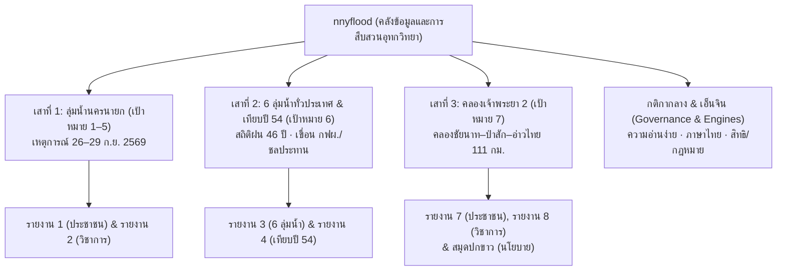

# แผนที่นำทางและแคตตาล็อกระบบ (Project Map & Knowledge Atlas)

> สถานะ: สร้าง 16 ต.ค. 2569 — ศูนย์กลางสืบค้นข้อมูล โค้ด ตัวเลข กติกา และเอกสารของโปรเจกต์
> สำหรับค้นหาความเชื่อมโยงระหว่าง **หัวข้อ $\leftrightarrow$ รายงาน $\leftrightarrow$ โค้ดวิเคราะห์ $\leftrightarrow$ ตัวเลขทางการ $\leftrightarrow$ เอกสารสเปก**

---

## 1. โครงสร้าง 3 เสาหลักของโปรเจกต์ (Three Pillars Overview)



| เสาหลัก | ขอบเขตเนื้อหา | รายงานหลัก (HTML) | ตัวสร้าง (Builder) | ตัวเลขทางการ (Canonical JSON) | เอกสารหลัก |
|---|---|---|---|---|---|
| **เสาที่ 1: นครนายก (เป้าหมาย 1–5)** | การวิเคราะห์บทบาทฝนตกหนักเป็นแถบเทียบกับการระบายน้ำเขื่อนขุนด่านฯ, ไฮโดรกราฟ, ภาพถ่ายดาวเทียม Sentinel-1, แบบจำลองทำนายระดับน้ำ (Model v1) | `report/น้ำท่วมนครนายก2569_ประชาชน.html`<br>`report/น้ำท่วมนครนายก2569_วิชาการ.html` | `report/build_report_html.py`<br>`report/build_expert_report.py` | `analysis/canonical_numbers.json` | `docs/METHODS.md`<br>`docs/DATA_DICTIONARY.md`<br>`docs/ANALYSIS_PLAN.md`<br>`analysis/goal5_policy_proposals.md` |
| **เสาที่ 2: 6 ลุ่มน้ำ & เทียบปี 54 (เป้าหมาย 6)** | ขยายวิธีสืบสวนสู่ 6 ลุ่มน้ำ (เจ้าพระยา, ท่าจีน, ป่าสัก, บางปะกง–นครนายก, แม่กลอง, เพชรบุรี), พฤติกรรม 24 เขื่อนใหญ่, สถิติฝนรอบ 46 ปี, ชุดเทียบมาตรฐานปี 2554 vs 2569 | `report/ระลอกปลายกย2569.html`<br>`report/ชุดเทียบมาตรฐาน2554.html` | `report/goal6_build_report3_draft.py`<br>`report/goal6_build_report4_draft.py`<br>`python analysis/goal6_build_all.py` | `analysis/goal6/canonical.json` | `docs/GOAL6_PLAN.md`<br>`docs/GOAL6_HYDRO2D_PLAN.md`<br>`docs/GOAL6_PUBLIC_RELEASE_REVIEW.md` |
| **เสาที่ 3: คลองเจ้าพระยา 2 (เป้าหมาย 7)** | คลองระบายน้ำหลากชัยนาท–ป่าสัก–อ่าวไทย (111 กม.), คันคลองสูง 3.2–4.8 ม., ท่อลอด/ไซฟอนตัดคลองเดิม 34 จุด, อาคารบังคับน้ำ 99 แห่ง, ผลกระทบต่อ อ.องครักษ์, ธรรมาภิบาลสัญญา No Land No Contract | `report/คลองเจ้าพระยา2_ประชาชน.html`<br>`report/คลองเจ้าพระยา2_วิชาการ.html`<br>`report/สมุดปกขาว_เจ้าพระยา2.html` | `report/goal7_build_public.py`<br>`report/goal7_build_academic.py`<br>`report/goal7_build_policy_brief.py`<br>`python report/goal7_build_all.py` | `analysis/goal7/canonical.json`<br>`analysis/goal7/gaps.json` | `docs/GOAL7_PLAN.md`<br>`docs/GOAL7_FOI_REQUESTS.md`<br>`docs/BANGBAN_BANGSAI_COMPARISON.md`<br>`docs/GOAL7_POLICY_BRIEF.md` |
| **ส่วนกลาง: กติกา & เอ็นจิน** | กติกาบังคับ AI, กฎหมายหมิ่นประมาทและ PDPA, ข้อตกลงรูปแบบรายงาน, สรีรศาสตร์สายตา, ระบบทดสอบภาษาไทย, การจัดการความสอดคล้องข้อมูล | `index.html` (หน้ารวมพอร์ทัล) | `report/goal7_engine.py`<br>`report/goal6_reportlib.py`<br>`report/goal7_blocks.py` | - | `AGENTS.md`<br>`docs/REPORT_CONVENTIONS.md`<br>`docs/DATA_CONSISTENCY_WORKFLOW.md`<br>`docs/LEGAL_REVIEW.md`<br>`docs/DATA_SOURCES.md`<br>`docs/ENVIRONMENT.md` |

---

## 2. ตารางสืบค้นตามประเด็น (Topic Discovery Matrix)

หากต้องการค้นหาข้อมูลหรือโค้ดในหัวข้อเฉพาะ ให้ใช้ตารางนี้เป็นสารบัญหลัก:

| ประเด็นคำถาม / การวิเคราะห์ | รายงาน HTML | สคริปต์วิเคราะห์ (Analysis) | ข้อมูลต้นทาง / โฟลเดอร์ | ตัวเลขทางการ / เอกสารอ้างอิง |
|---|---|---|---|---|
| **สัดส่วนสาเหตุ ฝน vs เขื่อนขุนด่านฯ (88% : 12%)** | รายงาน 1, 2 | `analysis/attribution_share.py` | `data/01_rid_khun_dan/`, `data/02_thaiwater/` | `analysis/canonical_numbers.json` $\rightarrow$ `attribution` |
| **ระดับน้ำและอัตราไหลแม่น้ำนครนายก (NY.1B, NY.7)** | รายงาน 1, 2 | `analysis/rid_cross_section_stage_rating.py`<br>`analysis/fetch_multistation_levels.py` | `data/02_thaiwater/`<br>`analysis/multistation_levels_sep2026_30d.json` | `docs/METHODS.md`<br>`analysis/rid_cross_section_stage_rating.json` |
| **อ่างขนาดกลาง 6 แห่ง จ.นครนายก (สมดุลน้ำ & การล้น)** | รายงาน 1, 2 | `analysis/goal2_nny_medium_dams.py` | `data/23_rid_swoc/` | `analysis/goal2_nny_medium_dams_summary.json`<br>`analysis/goal2_nny_medium_dams_report.md` |
| **เส้นฐานเขื่อนขุนด่านฯ 22 ปี & น้ำพีคเร็วกว่าปกติ** | รายงาน 1, 2 | `analysis/goal2_khundan_22y_baseline.py` | `data/23_rid_swoc/` | `analysis/goal2_khundan_22y_summary.json`<br>`analysis/goal2_khundan_22y_report.md` |
| **ภาพถ่ายดาวเทียมน้ำท่วมนครนายก (Sentinel-1)** | รายงาน 1 | `analysis/s1_peak_flood_map.py`<br>`analysis/s1_change_detect.py` | `data/13_sentinel1_copernicus/`<br>`analysis/s1_peak_flood_map_27sep1828.png` | `analysis/canonical_numbers.json` $\rightarrow$ `flood_extent` |
| **โมเดลทำนายระดับน้ำล่วงหน้า (Model v1, 11 ตัวแปร)** | รายงาน 2 | `analysis/goal4_model_v1.py`<br>`analysis/goal4_thachang_model.py` | `analysis/waterlevel_hourly_Ny7_2025_2026.csv`<br>`analysis/dam_khun_dan_daily_2013_2026.csv` | `analysis/goal4_model_v1_results.json`<br>`docs/ANALYSIS_PLAN.md` |
| **ข้อเสนอเชิงนโยบายการบริหารน้ำ (Policy Proposals)** | รายงาน 1, 2 | - | - | `analysis/goal5_policy_proposals.md`<br>`analysis/firo_dynamic_rulecurve_proposal.md` |
| **น้ำท่วม 6 ลุ่มน้ำระลอกปลาย ก.ย. 69 (ดาวเทียม)** | รายงาน 3 | `analysis/goal6_s1_landcover.py`<br>`analysis/goal6_s1_rule_validation.py` | `data/22_goal6_network/`<br>`data/31_external_landcover/` | `analysis/goal6/canonical.json` $\rightarrow$ `basins` |
| **ชั้นข้อมูลน้ำท่วมทางการ GISTDA (Disaster Platform)** | รายงาน 1, 2, 3 | `analysis/goal6_fetch_gistda_flood.py`<br>`analysis/gistda_georef_compare.py` | `data/12_gistda_flood/` | `analysis/gistda_platform_findings.md`<br>`analysis/goal6/canonical.json` |
| **การบริหารน้ำ 24 เขื่อนใหญ่ (กฟผ. vs ชลประทาน)** | รายงาน 3, 4 | `analysis/goal6_dam_history_all.py`<br>`analysis/goal6_dam_inflow.py` | `data/02_thaiwater/`<br>`analysis/goal6/canonical.json` | `analysis/goal6/canonical.json` $\rightarrow$ `dams` |
| **เส้นฐานเขื่อนป่าสักฯ 24 ปี & การหน่วงน้ำวิกฤต (Surcharge)** | รายงาน 3, 4 | `analysis/goal6_pasak_24y_baseline.py` | `data/23_rid_swoc/` | `analysis/goal6/pasak_24y_summary.json`<br>`analysis/goal6/pasak_24y_report.md` |
| **ดัชนีความเค้นอ่างขนาดกลาง 461 แห่งทั่วประเทศ** | รายงาน 3, 4 | `analysis/goal6_national_medium_reservoirs.py` | `data/23_rid_swoc/` | `analysis/goal6/national_medium_reservoirs_summary.json`<br>`analysis/goal6/national_medium_reservoirs_report.md` |
| **สถิติฝนตกหนักย้อนหลัง 46 ปี (ERA5/POWER)** | รายงาน 3, 4 | `analysis/goal6_rain_rarity.py`<br>`analysis/goal6_basin_rain.py` | `data/22_goal6_network/`<br>`analysis/goal6/canonical.json` | `analysis/goal6/canonical.json` $\rightarrow$ `rainfall_stats` |
| **สถาปัตยกรรมข้อมูลศูนย์ปฏิบัติการน้ำ (SWOC RID)** | ทุกรายงาน | `analysis/common_fetch_rid_swoc.py` | `data/23_rid_swoc/` | `docs/RID_SWOC_GUIDE.md`<br>`docs/DATA_SOURCES.md` §7 |
| **คุณภาพน้ำและความเค็มปากแม่น้ำ (ลิ่มความเค็มสำแล)** | ทุกรายงาน | `analysis/common_fetch_water_quality.py` | `data/24_estuary_waterquality/` | `docs/ESTUARY_AND_WEATHER_GUIDE.md` §2 |
| **ความลึกและแบบจำลองคลื่นอ่าวไทย (SWAN 31 สถานี)** | รายงาน 3, 4 | `analysis/common_fetch_gulf_marine.py` | `data/25_gulf_marine_tides/` | `docs/ESTUARY_AND_WEATHER_GUIDE.md` §3 |
| **ฝนสถานีโทรมาตรอัตโนมัติทั่วประเทศ (4,593 จุด)** | รายงาน 1, 3 | `analysis/common_fetch_rain_stations.py` | `data/26_national_rainfall_stations/` | `docs/ESTUARY_AND_WEATHER_GUIDE.md` §4 |
| **พยากรณ์อากาศและน้ำท่า (ECMWF & GloFAS 17 ปี)** | รายงาน 1, 2, 3 | `analysis/common_fetch_weather_forecasts.py` | `data/27_weather_flood_forecasts/` | `docs/ESTUARY_AND_WEATHER_GUIDE.md` §5 |
| **คลองเจ้าพระยา 2: ทำไมคันคลองสูง 3.2–4.8 ม. (คลองลอย)** | รายงาน 7, 8 | `analysis/goal7_analysis.py` | `data/32_goal7_chaophraya2/`<br>`data/manual/` | `analysis/goal7/canonical.json` $\rightarrow$ `embankment` |
| **คลองเจ้าพระยา 2: ท่อลอด/ไซฟอนตัดคลองเดิม (34 จุด)** | รายงาน 7, 8 | `analysis/goal7_eia_structs.py`<br>`analysis/goal7_analysis.py` | `data/manual/ป่าสัก-อ่าวไทย-ระยะที่2/`<br>`analysis/goal7/canonical.json` | `analysis/goal7/canonical.json` $\rightarrow$ `eia_structs` |
| **คลองเจ้าพระยา 2: ผลกระทบต่อ อ.องครักษ์ & ผังน้ำ สทนช.** | รายงาน 7, 8 | `analysis/goal7_waterchart_overlay.py` | `data/manual/` | `analysis/goal7/canonical.json` $\rightarrow$ `waterchart` |
| **คลองเจ้าพระยา 2: ทะเบียนช่องว่างข้อมูล (# gap: id)** | รายงาน 7, 8 | `analysis/goal7_gaps_check.py` | `analysis/goal7/gaps.json` | `analysis/goal7/gaps.json`<br>`docs/GOAL7_FOI_REQUESTS.md` |
| **คลองเจ้าพระยา 2: จำลองสถานการณ์สมมติ (2554 vs 2569)** | รายงาน 7, 8 | `analysis/goal7_counterfactual_simulation.py` | `data/02_thaiwater/`<br>`analysis/goal7/canonical.json` | `analysis/goal7/canonical.json` $\rightarrow$ `cp2_bypass_counterfactual` |
| **คลองเจ้าพระยา 2: บทเรียนเปรียบเทียบคลองบางบาล–บางไทร** | รายงาน 7, 8 | `analysis/goal7_bangban_bangsai_comparison.py` | `docs/BANGBAN_BANGSAI_COMPARISON.md` | `analysis/goal7/canonical.json` $\rightarrow$ `bangban_bangsai_case` |
| **คลองเจ้าพระยา 2: หน้าต่างใช้งานจริง สถิติ S.26 39 ปี และเศรษฐศาสตร์วงจรชีวิต** | รายงาน 7, 8 | `analysis/goal7_operational_economics.py` | `docs/GOAL7_POLICY_BRIEF.md` | `analysis/goal7/canonical.json` $\rightarrow$ `operational_economics` |
| **คลองเจ้าพระยา 2: ประวัติการพิจารณา EIA และข้อท้วงติง คชก. 3 รอบ** | รายงาน 7, 8 | `analysis/goal7_operational_economics.py` | `docs/GOAL7_POLICY_BRIEF.md` | `analysis/goal7/canonical.json` $\rightarrow$ `operational_economics` |
| **1D Hydrodynamic Routing แม่น้ำนครนายก (Ny.1B ถึง Ny.7)** | รายงาน 1, 2 | `analysis/hydraulic_1d_routing.py` | `data/19_rid_cross_sections/`<br>`data/02_thaiwater/` | `analysis/hydraulic_1d_routing_summary.json` |
| **โมเดล L3 ผสานขอบเขตทะเลหนุน & คลื่นอ่าวไทย (C.12 สามเสน)** | รายงาน 3, 4 | `analysis/goal6_l3_coastal_model.py` | `data/22_goal6_network/`<br>`data/25_gulf_marine_tides/` | `analysis/goal6/canonical.json` $\rightarrow$ `l3_coastal_coupled` |
| **เมทริกซ์ความเสี่ยงน้ำหลากปะทะน้ำหนุน (C.12 สามเสน)** | รายงาน 3 | `analysis/compound_flood_risk.py` | `data/22_goal6_network/`<br>`data/25_gulf_marine_tides/` | `analysis/goal6/canonical.json` $\rightarrow$ `compound_flood_risk` |
| **สรีรศาสตร์สายตา, กราฟภาษาไทย, มาตรฐาน WCAG** | ทุกรายงาน | `report/goal7_common.py`<br>`report/goal6_reportlib.py` | - | `docs/REPORT_CONVENTIONS.md`<br>`AGENTS.md` |
| **ตัวตรวจภาษาไทยอัตโนมัติ (Typo, คำชน, คำทับศัพท์)** | ทุกเอกสาร | `tests/test_thai_language_lint.py` | - | `tests/test_thai_language_lint.py`<br>`docs/REPORT_CONVENTIONS.md §11` |
| **เครื่องมือตรวจความสมบูรณ์และมาตรฐานแบบครบวงจร** | ระบบกลาง | `tools/verify_all.py` | - | `tools/verify_all.py` (catalog + SHA-256 + pytest) |
| **การจัดการความสอดคล้องข้อมูลและระงับข้อขัดแย้งหลายแหล่ง** | ทุกรายงาน | `tests/test_data_consistency.py` | - | `docs/DATA_CONSISTENCY_WORKFLOW.md`<br>`tests/test_data_consistency.py` |

---

## 3. สารบัญสคริปต์ใน [analysis/](file:///e:/theera/code/flood/analysis) ตามหน้าที่การทำงาน

เพื่อลดความสับสนของไฟล์กว่า 199 ไฟล์ใน `analysis/` สคริปต์ทั้งหมดถูกจัดกลุ่มตามหน้าที่หลักดังนี้:

### กลุ่ม ก: สคริปต์ดึงและรวบรวมข้อมูลดิบ (Data Ingestion & Extraction)
- `common_fetch_rid_swoc.py`: ดึงประวัติเขื่อนใหญ่-กลาง 20–30 ปี และรูปตัดขวางลำน้ำจริงจาก SWOC RID
- `common_fetch_water_quality.py`: ดึงคุณภาพน้ำและความเค็มปากแม่น้ำ 4 สาย ย้อนหลัง 9 ปี (2561–2569) และสแนปช็อต 112 สถานี
- `common_fetch_gulf_marine.py`: ดึงแบบจำลองคลื่น SWAN และความลึกทะเลอ่าวไทย 31 สถานี
- `common_fetch_rain_stations.py`: ดึงฝนสถานีโทรมาตรอัตโนมัติ 4,593 จุดทั่วประเทศ (5 หน่วยงาน)
- `common_fetch_weather_forecasts.py`: ดึงพยากรณ์อากาศ ECMWF IFS 16 วัน และน้ำท่า GloFAS 16 วัน + ประวัติน้ำท่า 17 ปี (2553–2569)
- `fetch_khundan_*.py`: ดึงข้อมูลโทรมาตรและระดับน้ำเขื่อนขุนด่านฯ ย้อนหลังหลายปี
- `fetch_multistation_levels.py`: ดึงระดับน้ำแม่น้ำรายชั่วโมงข้ามสถานี
- `goal6_s1_download.py`, `goal6_s1_queue.py`: ดาวน์โหลดและจัดการคิวดาวเทียม Sentinel-1 จาก CDSE
- `goal6_s2_queue.py`: จัดการคิวดาวเทียม Sentinel-2
- `goal6_dam_history_all.py`: ดึงประวัติระดับน้ำเขื่อนรายวัน 24 เขื่อนย้อนหลัง
- `goal7_ocr.py`, `goal7_ocr_scan.py`: สกัดข้อความและตัวเลขจากเล่มรายงาน EIA PDF

### กลุ่ม ข: สถิติอุทกวิทยาและฝน (Hydrology & Rainfall Statistics)
- `attribution_share.py`: แยกส่วนสาเหตุฝน vs เขื่อนขุนด่านฯ (เป้าหมาย 3)
- `rain_window.py`: คำนวณฝนสะสมตามหน้าต่างเวลา (ฟังก์ชันร่วม)
- `goal2_nny_medium_dams.py`: วิเคราะห์สมดุลน้ำและการล้นของอ่างขนาดกลาง 6 แห่ง จ.นครนายก (2552–2569)
- `goal2_khundan_22y_baseline.py`: สร้างเส้นฐาน 22 ปีเขื่อนขุนด่านฯ และวิเคราะห์ความผิดปกติของช่วงเวลาน้ำสูงสุด
- `goal6_pasak_24y_baseline.py`: สร้างเส้นฐาน 24 ปีเขื่อนป่าสักชลสิทธิ์ และการหน่วงน้ำในช่องความจุเผื่อวิกฤต (Surcharge)
- `goal6_national_medium_reservoirs.py`: วิเคราะห์ดัชนีความเค้นและสัดส่วนน้ำล้นของอ่างขนาดกลาง 461 แห่งทั่วประเทศ
- `goal6_basin_rain.py`: คำนวณปริมาณฝนเฉลี่ยรายลุ่มน้ำ (HydroBASINS × POWER)
- `goal6_rain_rarity.py`, `goal6_rain_rarity_2554.py`: วิเคราะห์รอบปีการเกิดซ้ำ (Return Period) ของฝน 46 ปี
- `goal6_dam_inflow.py`: คำนวณสมดุลน้ำเข้า–ออก–เก็บรายวัน

### กลุ่ม ค: การประมวลผลดาวเทียมและผังน้ำ (Remote Sensing & GIS)
- `s1_process.py`, `s1_change_detect.py`, `s1_peak_flood_map.py`: สกัดพื้นที่น้ำท่วมจาก Sentinel-1 (ลุ่มน้ำนครนายก)
- `goal6_s1_stage1.py`, `goal6_s1_stage2_water.py`: สกัดน้ำท่วมระดับชาติ
- `goal6_fetch_gistda_flood.py`: ดึงข้อมูลขอบเขตน้ำท่วมสะสม 30 วันและประวัติความถี่ 14 ปี จาก GISTDA Disaster Platform API
- `goal6_s1_landcover.py`: จำแนกประเภทผิวดิน (WorldCover) และหักลบน้ำถาวร (JRC) เพื่อหา "น้ำใหม่เข้มงวด"
- `goal6_s1_rule_validation.py`: สอบเทียบเกณฑ์ความแม่นยำ F1-score และฉากควบคุม
- `goal6_s1_control_rain.py`: เทียบฝนก่อนเหตุการณ์กับค่าควบคุมของเรดาร์ 13 คู่ (กติกา `docs/S1_CONTROL_RAIN_PREREG.md` · บรรยายเท่านั้น)
- `goal7_waterchart_overlay.py`: ซ้อนทับแนวคลองกับผังน้ำ สทนช. (พื้นที่ทางน้ำหลาก & น้ำท่วม 100 ปี)

### กลุ่ม ง: ชลศาสตร์และแบบจำลองคณิตศาสตร์ (Hydraulics & Modeling)
- `rid_cross_section_stage_rating.py`: ถอดความสัมพันธ์ระดับน้ำ–อัตราไหล (Stage-discharge rating curve) แม่น้ำนครนายก
- `hydraulic_1d_routing.py`: แบบจำลองชลศาสตร์ 1 มิติ (Muskingum-Cunge routing ที่ X=0 เทียบเท่าถังเก็บน้ำเชิงเส้น — ไม่ใช่ Saint-Venant เต็มรูป) แม่น้ำนครนายก (Ny.1B ถึง Ny.7)
- `goal4_model_v1.py`: แบบจำลองทำนายระดับน้ำล่วงหน้า 11 ตัวแปร (นครนายก)
- `goal4_counterfactual_model.py`: จำลองฉากทัศน์เปรียบเทียบกรณีปรับเกณฑ์บริหารน้ำ
- `goal6_l3_model.py`: โมเดลระดับชาติ 6 ลุ่มน้ำ
- `goal6_l3_coastal_model.py`: โมเดลพยากรณ์ระดับน้ำเจ้าพระยาตอนล่างผสานขอบเขตทะเลหนุนปากแม่น้ำ (CPY015) และคลื่นลมทะเลอ่าวไทย
- `compound_flood_risk.py`: เมทริกซ์ประเมินความเสี่ยงน้ำเหนือหลากปะทะน้ำทะเลหนุน (C.12 สามเสน กทม.)
- `tools/doctor.py` + `tools/registry.json`: ทะเบียนเครื่องมือ/สภาพแวดล้อม (แหล่งความจริงเดียว) · doctor ตรวจและสร้างส่วนเครื่องมือของ `docs/ENVIRONMENT.md` · อยู่ใน `verify_all` เป็นขั้นเตือน (รอบ 6)
- `goal7_source_constants.py` + `goal7_verify_constants.py` + `analysis/goal7/source_constants.json`: ค่าคงที่นำเข้าเป้าหมาย 7 พร้อมหน้า/ตาราง/รูปอ้างอิงและผลตรวจกับ PDF EIA (รอบ 6) — สคริปต์เรียก `value('<id>')` ไม่พิมพ์ตัวเลขตรง
- `goal7_ocr_coverage.py` + `goal7_typhoon_queue_eia.py`: วัดความครอบคลุม OCR ของเล่ม EIA 2569 และรันคิว Typhoon-OCR (หน้าสแกนก่อน แล้วหน้ารูป; 2 worker; หน้า echo/ถอดไม่ได้ทำเครื่องหมาย needs_visual) → `analysis/goal7/ocr_coverage.json` · ผลบนดิสก์ `typhoon_ocr/eia2569_<เล่ม>/` · ค้นด้วย `python tools/mini_fts.py "<คำค้น>"` (ทำดัชนีชั้นข้อความ EIA + Typhoon รายหน้า)
- `tools/number_inventory.py`: บัญชีตัวเลขทั้งคลัง (ค่าขัดกัน · ตัวเลขกำพร้า · คีย์ JSON ขัด · literal ใน builder · เอกสารล้าสมัย) → `docs/reviews/INVENTORY_*.md` (รอบ 6 R7-07)
- `goal6_tide_gain_regression.py`: ถดถอยอัตราส่งผ่านน้ำหนุนสู่ระดับน้ำ C.12 (Newey–West, ฤดู 2569) → `analysis/goal6/tide_gain_regression.json` ใช้เป็นความไวของเมทริกซ์ข้างบน (รอบ 6 C1)
- `hecras_lite_channel.py`: การคำนวณทางชลศาสตร์เบื้องต้นของคลอง

### กลุ่ม จ: การสืบค้นและวิเคราะห์คลองเจ้าพระยา 2 (Goal 7 Analysis)
- `goal7_analysis.py`: สคริปต์หลักวิเคราะห์มิติกายภาพ ความสูงคัน น้ำเท้อ ทางเลือกเชิงวิศวกรรม
- `goal7_eia_structs.py`: จำแนกตารางอาคารประกอบ 99 แห่ง และไซฟอนลอดคลองเดิม 34 จุด
- `goal7_gaps_check.py`: ตรวจสอบและรายงานสถานะทะเบียนช่องว่างข้อมูล (`gaps.json`)
- `goal7_counterfactual_simulation.py`: จำลองสมดุลน้ำและการตัดยอดน้ำหลากกรณีมีคลองเจ้าพระยา 2 ในมหาอุทกภัย 2554 และ 2569
- `goal7_dam_to_gulf_hydraulics.py`: วิเคราะห์ 3 ระเบียงชลศาสตร์ เวกเตอร์การไหล และเวลาเดินทางจากเขื่อนสู่ปากอ่าวไทย
- `goal7_bangban_bangsai_comparison.py`: วิเคราะห์เปรียบเทียบเชิงวิศวกรรมและเศรษฐศาสตร์ คลองบางบาล–บางไทร สู่เจ้าพระยา 2
- `goal7_operational_economics.py`: วิเคราะห์หน้าต่างเดินน้ำจริงสถานี S.26 (39 ปี), เศรษฐศาสตร์วงจรชีวิต (LCC), และประวัติ EIA ตีกลับ 2 รอบ
- `goal7_dem_waterline_test.py`: ทดสอบ DEM 3 ชุด (Copernicus ดิบ · FABDEM ดิบ · FABDEM ปรับ) ด้วยขอบน้ำท่วมเรดาร์ Sentinel-1 ใน อ.องครักษ์ — ผลใน `analysis/goal7/dem_waterline_test.json`
- `goal7_dem_gistda_waterline_test.py`: ทดสอบ DEM 3 ชุดด้วยขอบเขตน้ำท่วมรายปีของ GISTDA (2548–2562) ใน อ.องครักษ์ — ผลใน `analysis/goal7/dem_gistda_waterline_test.json`
- `goal7_vlm_pilot.py`: นำร่องเทียบแบบจำลองภาพ-ภาษาอ่านตาราง ภาพวาด และหน้าผสม พร้อมเฉลยที่ตรวจแล้ว (ผลเป็นร่าง ห้ามนำไปใช้ก่อนเทียบภาพหน้า)
- `goal7_bangpakong_fetch.py` + `goal7_bangpakong_chachoengsao.py`: ดึงระดับน้ำสถานีลุ่มบางปะกงเทียบตลิ่ง และวิเคราะห์ทั้งลุ่ม (ความสูง ลุ่มรับน้ำ น้ำท่วม 30 วัน ความถี่ 14 ปี) เพื่ออธิบายว่าทำไมฉะเชิงเทรา ท่วมหนักและนาน — ผลใน `analysis/goal7/bangpakong_chachoengsao.json`
- `goal7_layout_compare.py`: เทียบตัวแยกส่วนหน้าเอกสาร (Unlimited-OCR · PP-DocLayoutV3) กับเฉลยกรอบรูป/ภาพวาด — ผลใน `analysis/goal7/layout_compare.json`
- `goal7_ocr_v2.py`: OCR รุ่นที่ 2 สำหรับหน้า needs_visual ของ EIA (แยกส่วนหน้า → ภาพย่อย → โมเดลภาพอ่านแบบขยายคมชัด) — ผลเป็นร่างใน `data/32_goal7_chaophraya2/ocr_v2/` และสรุปใน `analysis/goal7/ocr_v2_summary.json`
- `goal7_ocr_poster_tiles.py`: ถอดความบอร์ดนิทรรศการขนาดยักษ์ด้วย Typhoon-OCR แบบแบ่งแถบซ้อนเหลื่อม (แก้ 11 หน้าที่เคยล้มเพราะหน่วยความจำการ์ดจอไม่พอ · R7-13)
- `goal7_mitrearth_road_valley.py`: จุดที่ถนนตัดร่องน้ำ (ชั้นมิตรเอิร์ธ) ในอำเภอองครักษ์ เทียบความสูงพื้นดินกับระดับน้ำจริง — ชั้นสุดท้ายของ R7-14 (ความสูงพื้นดินเปล่า ไม่ใช่ระดับผิวถนน) → `analysis/goal7/mitrearth_road_valley.json`
- `goal7_indra_probe.py` + `goal7_indra_text_eval.py`: ทดลอง Indra OCR (CPU) กับหน้าตัวอย่างนำร่องและวัดความแม่นยำไทยเทียบชั้นข้อความ PDF — ผลใน `analysis/goal7/indra_probe.json` และ `indra_text_eval.json`
- `goal7_indra_vs_typhoon.py`: เทียบตัวเลขที่ Typhoon กับ Indra OCR ถอดได้บนทุกหน้าที่ Typhoon เคยอ่าน เพื่อชี้หน้าที่ควรตรวจด้วยตา — ผลใน `analysis/goal7/indra_vs_typhoon.json`
- `goal7_ocr_accuracy_vs_textlayer.py`: เทียบ Typhoon กับ Indra OCR บนหน้าที่มีชั้นข้อความ PDF (เฉลยแน่นอน) — ผลใน `analysis/goal7/ocr_accuracy_vs_textlayer.json`
- `goal7_indra_ocr_all.py`: Indra OCR (CPU) อ่านทุกหน้าที่ Typhoon เคยอ่าน เก็บเป็นชุดผลถอดคู่ขนานใน `data/32_goal7_chaophraya2/indra_ocr/`
- `goal7_gap_reprobe.py`: ค้นคำสำคัญของช่องว่างที่ยังเปิดซ้ำบนผลถอด Typhoon/Indra/ชั้นข้อความ PDF — ผลใน `analysis/goal7/gap_reprobe.json`
- `goal7_ocr_v2_tiers.py`: สรุปภาพย่อยที่ตัวอ่านหลายตัวอ่านตัวเลขตรงกันจาก OCR รุ่นที่ 2 — ผลใน `analysis/goal7/ocr_v2_high_tier.json`
- `goal7_ongkharak_hydraulic_2d.py`: แบบจำลองชลศาสตร์ 2 มิติของที่ราบองครักษ์ (น้ำเข้าที่ Ny.7) — ผลใน `analysis/goal7/ongkharak_hydraulic_2d.json` · ผลรอบแรกไม่สามารถทำซ้ำพื้นที่น้ำท่วมที่ดาวเทียมเห็น
- `goal7_event_rain.py`: ฝนรายวันสถานีรอบที่ราบองครักษ์ช่วงเหตุการณ์ 20 ก.ย.–4 ต.ค. 2569 → สนามฝนรายวันบนกริดแบบจำลอง (IDW) — ผลใน `analysis/goal7/event_rain_summary.json`
- `goal7_gistda_stac_daily.py`: ดึงผลิตภัณฑ์น้ำท่วมรายวัน/รายฉากของ GISTDA จากคลัง STAC แล้วสรุปพื้นที่ต่อวัน ต่อจังหวัด — ผลใน `analysis/goal7/gistda_stac_daily.json`
- `report/goal6_bp_downstream.py`: ส่วนเพิ่ม 4.7 ของรายงานเป้าหมาย 6 ฉบับ 3 (ท้ายน้ำบางปะกง/ฉะเชิงเทรา) เรนเดอร์จาก canonical.bp_downstream — ติดป้ายวิเคราะห์เพิ่มเติม
- `goal7_batch_ocr_queue.py`: ตัวขับเคลื่อนคิวถอดความเอกสารภาพสแกน EIA และเอกสารรับฟังความคิดเห็นอัตโนมัติบน GPU RTX 4090

### กลุ่ม ฉ: ผู้สร้างตัวเลขทางการและการตรวจสอบระบบ (Canonical Builders & QA)
- `build_canonical_numbers.py` $\rightarrow$ ผลิต `analysis/canonical_numbers.json` (เป้าหมาย 1–5)
- `goal6_canonical.py` $\rightarrow$ ผลิต `analysis/goal6/canonical.json` (เป้าหมาย 6)
- `goal6_build_all.py`: รันวิเคราะห์ $\rightarrow$ สร้าง canonical $\rightarrow$ build รายงาน 3, 4 $\rightarrow$ รันเทสต์เป้าหมาย 6
- `verify_data_integrity.py`: ตรวจสอบค่าแฮช SHA-256 ของไฟล์ข้อมูลดิบทั้งหมด 3,348 รายการ
- `tools/verify_all.py`: ตัวตรวจความสมบูรณ์และมาตรฐานแบบครบวงจร 4 ขั้นตอน (สารบัญ, SHA-256, pytest lint, pytest ทั้งหมด)
- `tools/write_verification.py`: ประทับผลตรวจจริง 4 ด่าน (ภาษา · สี · กฎหมาย/ข้อมูลส่วนบุคคล · ตัวเลขกลาง) ลง `report/assets/verification.json` ให้ป้ายท้ายรายงานอ่าน — `verify_all.py` เรียกให้อัตโนมัติ (รีวิวรอบ 7)

---

## 4. สารบัญเอกสารใน [docs/](file:///e:/theera/code/flood/docs)

| ไฟล์เอกสาร | จุดประสงค์และเนื้อหา |
|---|---|
| [REPORT_CONVENTIONS.md](file:///e:/theera/code/flood/docs/REPORT_CONVENTIONS.md) | **ข้อตกลงการทำรายงาน**: เอ็นจิน key+โทเคน, ชิ้นส่วนร่วม, ธีมและสี WCAG, สรีรศาสตร์สายตา (สเกลบ้าน 2 ชั้น), ป้ายหน้ารวม, ตัวตรวจภาษาไทย |
| [LEGAL_REVIEW.md](file:///e:/theera/code/flood/docs/LEGAL_REVIEW.md) | **คู่มือกฎหมาย**: แนวปฏิบัติป้องกันการหมิ่นประมาท (เน้นวิจารณ์ระบบ ไม่วิจารณ์บุคคล) และการคุ้มครองข้อมูลส่วนบุคคล (PDPA) |
| [DATA_SOURCES.md](file:///e:/theera/code/flood/docs/DATA_SOURCES.md) | **บัญชีแหล่งข้อมูล**: วิธีเชื่อมต่อ API Thaiwater, CDSE Sentinel, Copernicus DEM, ข้อมูลผังน้ำ สทนช. |
| [BANGBAN_BANGSAI_COMPARISON.md](file:///e:/theera/code/flood/docs/BANGBAN_BANGSAI_COMPARISON.md) | **บทเรียนเชิงวิศวกรรมและเศรษฐศาสตร์**: การศึกษาเปรียบเทียบคลองระบายน้ำหลากบางบาล–บางไทร (อยุธยา) สู่โครงการเจ้าพระยา 2 (สาเหตุความล่าช้า งบบานปลาย และฉากทัศน์ความเสี่ยง) |
| [GOAL7_POLICY_BRIEF.md](file:///e:/theera/code/flood/docs/GOAL7_POLICY_BRIEF.md) | **รายงานสรุปเชิงนโยบาย**: ถอดบทเรียนความเสี่ยง ธรรมาภิบาลสัญญา No Land No Contract ธรณีวิทยารอยเลื่อนองครักษ์ ดินเปรี้ยวจัด และทางเลือกเชิงยุทธศาสตร์ |
| [RID_SWOC_GUIDE.md](file:///e:/theera/code/flood/docs/RID_SWOC_GUIDE.md) | **คู่มือระบบศูนย์ปฏิบัติการน้ำอัจฉริยะ (SWOC RID)**: สถาปัตยกรรม API, พารามิเตอร์, ข้อมูลอ่างขนาดกลาง 461 แห่ง, ประวัติเขื่อน 20–30 ปี และรูปตัดขวางลำน้ำจริง |
| [THAIWATER_API_GUIDE.md](file:///e:/theera/code/flood/docs/THAIWATER_API_GUIDE.md) | **คู่มือ API คลังข้อมูลน้ำแห่งชาติและโทรมาตรเขื่อนขุนด่านฯ**: การเรียกข้อมูลเขื่อน, โทรมาตรแม่น้ำรายชั่วโมง, ฝนรายสถานี (31 วัน), ประตูระบายน้ำ 2,315 แห่ง, โทรมาตร 15 นาที 19 สถานี |
| [ESTUARY_AND_WEATHER_GUIDE.md](file:///e:/theera/code/flood/docs/ESTUARY_AND_WEATHER_GUIDE.md) | **คู่มือข้อมูลคุณภาพน้ำปากแม่น้ำ คลื่นอ่าวไทย ฝนโทรมาตร และการพยากรณ์น้ำท่า**: สถาปัตยกรรม API คุณภาพน้ำ 112 สถานี, ลิ่มความเค็มสำแล, คลื่น SWAN 31 สถานี, ฝนโทรมาตร 4,593 จุด, และพยากรณ์ ECMWF/GloFAS |
| [REMOTE_SENSING_APIS.md](file:///e:/theera/code/flood/docs/REMOTE_SENSING_APIS.md) | **คู่มือ API ดาวเทียมและข้อมูลกริดระดับชาติ**: GISTDA Disaster Platform, NASA POWER ฝน 46 ปี, Copernicus CDSE Sentinel-1/2 OData และ S3 |
| [IMPLEMENTATION_PLAN_ADVANCED_MODELING.md](file:///e:/theera/code/flood/docs/IMPLEMENTATION_PLAN_ADVANCED_MODELING.md) | **แผนและผลลัพธ์แบบจำลองขั้นสูง**: แบบจำลอง 1D Routing นครนายก, การจำลองสมมติคลองเจ้าพระยา 2 (2554 vs 2569), โมเดลพยากรณ์ผสานขอบเขตทะเลหนุน |
| [IMPLEMENTATION_PLAN_PORTAL_AND_ADVANCED_ANALYSIS.md](file:///e:/theera/code/flood/docs/IMPLEMENTATION_PLAN_PORTAL_AND_ADVANCED_ANALYSIS.md) | **แผนงานยกระดับพอร์ทัลและวิเคราะห์ขั้นสูง**: บูรณาการรายงาน 1–2, แผนที่โต้ตอบ Leaflet บน GitHub Pages, เมทริกซ์ความเสี่ยง, และ GitHub Actions CI |
| [REVIEW_PROMPT_COMPREHENSIVE.md](file:///e:/theera/code/flood/docs/REVIEW_PROMPT_COMPREHENSIVE.md) | **ชุดคำสั่งตรวจสอบระบบเดิม (Superseded)**: ถูกแทนที่ด้วย REVIEW_PROMPT_EN.md เพื่อให้เป็นชุดคำสั่งภาษาอังกฤษมาตรฐานเดียว |
| [REVIEW_PROMPT_EN.md](file:///e:/theera/code/flood/docs/REVIEW_PROMPT_EN.md) | **English Red-Team Review Prompt (ชุดคำสั่งหลัก)**: Comprehensive independent audit prompt for external LLMs / peer-reviewers (3 Pillars & Models) |
| [AUDIT_REDTEAM_2026-10-17.md](file:///e:/theera/code/flood/docs/reviews/AUDIT_REDTEAM_2026-10-17.md) | **รายงานผลการตรวจทานทางชลศาสตร์และวิทยาศาสตร์ข้อมูล (`docs/reviews/AUDIT_REDTEAM_2026-10-17.md`)**: ผลการตรวจสอบ 10 ประเด็น พร้อมการแก้ไขเสถียรภาพ 1D Routing, แก้ไข Feature รั่วไหล L3 ML, และการปรับปรุงกราฟจำลอง CP2 |
| [AUDIT_ROUND2_2026-10-17.md](file:///e:/theera/code/flood/docs/reviews/AUDIT_ROUND2_2026-10-17.md) | **ผลการตรวจสอบอิสระรอบที่ 2 (Delta Review)**: ตรวจซ้ำประเด็นรอบที่ 1 ว่าปิดจริงหรือไม่ พร้อมประเด็นใหม่ N-01 ถึง N-04 (canonical ledger drift, ไฟล์ตรวจสอบที่ยังไม่ลงทะเบียน) |
| [TRIAGE_ROUND7_2026-10-25.md](file:///e:/theera/code/flood/docs/reviews/TRIAGE_ROUND7_2026-10-25.md) | **การกลั่นกรองรีวิวอิสระรอบที่ 7**: ข้อที่ตรวจซ้ำแล้ว/งานแก้/คลังงานค้าง R7-23…35/ข้อที่ไม่รับ พร้อมสถานะความคืบหน้า (25 ต.ค. 69) |
| [DATA_DICTIONARY.md](file:///e:/theera/code/flood/docs/DATA_DICTIONARY.md) | **พจนานุกรมข้อมูล (เป้าหมาย 1–5)**: นิยามตัวแปร ค่าอ้างอิงความสูง (datum) ตัวเลขน้ำสูงสุด และพื้นที่น้ำท่วม |
| [METHODS.md](file:///e:/theera/code/flood/docs/METHODS.md) | **วิธีวิทยา (เป้าหมาย 1–5)**: ชั้นหลักฐาน `[F]/[I]/[O]`, การปรับเทียบระดับน้ำ, การกำกับความถูกต้อง |
| [ANALYSIS_PLAN.md](file:///e:/theera/code/flood/docs/ANALYSIS_PLAN.md) | **แผนการวิเคราะห์ดั้งเดิม**: กรอบการทำงานเป้าหมาย 1–5 |
| [GOAL6_PLAN.md](file:///e:/theera/code/flood/docs/GOAL6_PLAN.md) | **แผนและผลการวิเคราะห์เป้าหมาย 6**: รายละเอียด 6 ลุ่มน้ำ, เขื่อน 24 แห่ง, กฎการเก็บหลักฐานระดับชาติ |
| [GOAL6_HYDRO2D_PLAN.md](file:///e:/theera/code/flood/docs/GOAL6_HYDRO2D_PLAN.md) | แผนการพัฒนาแบบจำลองชลศาสตร์ 2 มิติ (2D Hydrodynamic Modeling) |
| [GOAL6_PUBLIC_RELEASE_REVIEW.md](file:///e:/theera/code/flood/docs/GOAL6_PUBLIC_RELEASE_REVIEW.md) | บันทึกการรีวิวและการเตรียมเผยแพร่เป้าหมาย 6 สู่สาธารณะ |
| [GOAL7_PLAN.md](file:///e:/theera/code/flood/docs/GOAL7_PLAN.md) | **แผนการวิเคราะห์เป้าหมาย 7**: โครงการคลองระบายน้ำหลากเจ้าพระยา 2, กรอบการสอบทาน EIA 4 ฉบับ |
| [GOAL7_FOI_REQUESTS.md](file:///e:/theera/code/flood/docs/GOAL7_FOI_REQUESTS.md) | รายการประเด็นที่ต้องยื่นขอข้อมูลข่าวสารราชการ (FOI) จากกรมชลประทานและ สทนช. |
| [DATA_REQUEST_PACK.md](file:///e:/theera/code/flood/docs/DATA_REQUEST_PACK.md) | ชุดคำขอข้อมูลรวมศูนย์ เรียงตามสิ่งที่ปลดล็อกได้มากที่สุด (เป้าหมาย 6–7) |
| [ENVIRONMENT.md](file:///e:/theera/code/flood/docs/ENVIRONMENT.md) | สภาพแวดล้อมระบบ เวอร์ชัน Python (3.11–3.14) และไลบรารีที่ปักหมุด |
| [OFFLINE_DATA_BACKLOG.md](file:///e:/theera/code/flood/docs/OFFLINE_DATA_BACKLOG.md) | บันทึกข้อมูลขนาดใหญ่บนดิสก์ที่ไม่ถูกจัดเก็บใน git |
| [OCR_WORKFLOW_V2.md](file:///e:/theera/code/flood/docs/OCR_WORKFLOW_V2.md) | **ขั้นตอน OCR รุ่นที่ 2** — แยกส่วนหน้าก่อน อ่านข้อความด้วย Typhoon และอ่านภาพย่อยด้วยโมเดลภาพ (บันทึกการตัดสินใจ 21 ต.ค. 69 · ยังไม่ใช้กับคิวที่ค้าง) |
| [DEM_CORRECTION_PREREG.md](file:///e:/theera/code/flood/docs/DEM_CORRECTION_PREREG.md) | **กติกาปรับความสูง DEM แบบต่อเนื่อง (ตั้งก่อนดูผล)** — แทนตารางขั้นบันไดเดิม · ชุดพื้นผิวที่รายงานเป็นช่วง · ขอบเขตการรันซ้ำ (B1 รีวิวรอบ 7 · 25 ต.ค. 69) |
| [HARMONICS_REFIT_PREREG.md](file:///e:/theera/code/flood/docs/HARMONICS_REFIT_PREREG.md) | **กติกาปรับฮาร์มอนิกน้ำขึ้นน้ำลงด้วยข้อมูลหลายปี (ตั้งก่อนดูผล)** — 10 องค์ประกอบ + ตัวแก้ปมจันทร์ · เทียบกับแบบ 4 องค์ประกอบเดิม · ชุดตัวอย่างร่วมทุกระยะ (R7-27 · 25 ต.ค. 69) |
| [HYDRAULIC2D_RERUN_PREREG.md](file:///e:/theera/code/flood/docs/HYDRAULIC2D_RERUN_PREREG.md) | **กติการันแบบจำลองน้ำท่วมฝน 2 มิติซ้ำ (ตั้งก่อนดูผล)** — 4 พื้นผิวความสูง · บัญชีน้ำปิดรอบ · ความไวน้ำเข้า ±20% · ตรวจความกำหนดได้ (R7-34/R7-28 · 25 ต.ค. 69) |
| [ROUTING1D_SUBREACH_PREREG.md](file:///e:/theera/code/flood/docs/ROUTING1D_SUBREACH_PREREG.md) | **กติกาตรวจความไวต่อการแบ่งช่วงย่อยของแบบจำลองไหล 1 มิติ (ตั้งก่อนดูผล)** — เพิ่มแถว 1–3 ช่วงย่อย · ตัวชี้วัดวินิจฉัย X/c1–c3 · ค่าหลักคงที่ 12 ช่วงย่อย (R7-24 · 25 ต.ค. 69) |
| [COMPOUND_ANCHORED_PREREG.md](file:///e:/theera/code/flood/docs/COMPOUND_ANCHORED_PREREG.md) | **กติกาเมทริกซ์น้ำท่วมซ้อนแบบยึดค่าที่วัด (ตั้งก่อนดูผล)** — อัตราส่งผ่านน้ำหนุนที่วัดได้ เทียบเมทริกซ์เดิม ช่องกริดและเกณฑ์เท่าเดิม (R7-26 · 26 ต.ค. 69) |
| [REACH_LENGTH_PREREG.md](file:///e:/theera/code/flood/docs/REACH_LENGTH_PREREG.md) | **กติกาวัดระยะตามลำน้ำ Ny.1B–Ny.7 (ตั้งก่อนดูผล)** — ชั้นเส้นลำน้ำมิตรเอิร์ธ ช่วงความไม่แน่นอน และข้อตีความที่ตกลงไว้ก่อน |
| [S1_PASS_MOSAIC_PREREG.md](file:///e:/theera/code/flood/docs/S1_PASS_MOSAIC_PREREG.md) | **กติกาหน่วยรอบถ่าย ขอบเขตสูงสุดรวมทุกวัน และความไวต่อฉากอ้างอิง (ตั้งก่อนดูผล)** |
| [S1_REF_SENSITIVITY_PASAK_PREREG.md](file:///e:/theera/code/flood/docs/S1_REF_SENSITIVITY_PASAK_PREREG.md) | **กติกาความไวต่อวันของฉากอ้างอิง ลุ่มป่าสัก (ตั้งก่อนดูผล)** |
| [S1_REF_SENSITIVITY_REST_PREREG.md](file:///e:/theera/code/flood/docs/S1_REF_SENSITIVITY_REST_PREREG.md) | **กติกาความไวต่อวันของฉากอ้างอิง 4 ลุ่มที่เหลือ (ตั้งก่อนค้นคลัง/ดึงฉาก/ดูผล)** |
| [S1_CONTROL_RAIN_PREREG.md](file:///e:/theera/code/flood/docs/S1_CONTROL_RAIN_PREREG.md) | **กติกาเทียบฝนก่อนเหตุการณ์กับค่าควบคุมของเรดาร์ (ตั้งก่อนคำนวณฝน)** |
| [S1_ORBIT31_CONTROL_PREREG.md](file:///e:/theera/code/flood/docs/S1_ORBIT31_CONTROL_PREREG.md) | **กติกาตรวจค่าควบคุมวงโคจร 31 ด้วยฉากอ้างอิงที่สาม (ตั้งก่อนค้นคลัง/ดึงฉาก/คำนวณ)** |
| [S1_GISTDA_CROSSCHECK_PREREG.md](file:///e:/theera/code/flood/docs/S1_GISTDA_CROSSCHECK_PREREG.md) | **กติกาเทียบพื้นที่น้ำเรดาร์กับ GISTDA 30 วัน (ตั้งก่อนดูผล)** — ความแม่น/ความครบต่อลุ่ม ไม่มีเกณฑ์ผ่านตก |
| [S1_REFERENCE_AUDIT_PREREG.md](file:///e:/theera/code/flood/docs/S1_REFERENCE_AUDIT_PREREG.md) | **กติกาตรวจฉากอ้างอิงเรดาร์ขั้นที่ 2 ของเป้าหมาย 6 (ตั้งก่อนดูผล)** — วินิจฉัยเท่านั้น ไม่เปลี่ยนตัวเลขเผยแพร่ |
| [S1_CHACHOENGSAO_RECENT_PREREG.md](file:///e:/theera/code/flood/docs/S1_CHACHOENGSAO_RECENT_PREREG.md) | **กติกาแผนที่น้ำเรดาร์ฉะเชิงเทรา 4–22 ต.ค. (ตั้งก่อนดูผล)** — จับคู่ตามวงโคจรสัมพัทธ์ ใช้กฎตรึงเดิม |

---

## 5. แหล่งเก็บตัวเลขทางการ (Canonical Numbers Directory)

ตามกฎของ [AGENTS.md](file:///e:/theera/code/flood/AGENTS.md) **ห้ามพิมพ์ตัวเลข metric เป็น literal** โดยตัวเลขทั้งหมดต้องมาจากไฟล์ JSON 3 ไฟล์นี้เท่านั้น:

1. **`analysis/canonical_numbers.json`** (เป้าหมาย 1–5: ลุ่มน้ำนครนายก)
   - ผลิตโดย: `python analysis/build_canonical_numbers.py`
   - ควบคุม: ปริมาณน้ำฝน, อัตราไหลน้ำสูงสุด, สัดส่วนฝน vs เขื่อน (88:12), พื้นที่น้ำท่วม, ค่าประเมินโมเดล Model v1
2. **`analysis/goal6/canonical.json`** (เป้าหมาย 6: 6 ลุ่มน้ำทั่วประเทศ)
   - ผลิตโดย: `python analysis/goal6_canonical.py`
   - ควบคุม: สถิติน้ำท่วมรายลุ่ม 6 แห่ง, สถิติน้ำเข้า-ออก 24 เขื่อนใหญ่, สถิติฝน 46 ปี, ชุดเทียบมาตรฐานปี 2554 vs 2569
3. **`analysis/goal7/canonical.json`** (เป้าหมาย 7: คลองเจ้าพระยา 2)
   - ผลิตโดย: `python analysis/goal7_analysis.py`
   - ควบคุม: ความสูงคันคลอง (3.2–4.8 ม.), จำนวนอาคารบังคับน้ำ (99 แห่ง), ไซฟอนตัดคลองเดิม (34 จุด), การตัดผ่านผังน้ำ สทนช., กรณีคำนวณทางเลือกวิศวกรรม
   - ทะเบียนช่องว่างข้อมูล: `analysis/goal7/gaps.json`

---

## 6. เครื่องมือช่วยสืบค้นอัตโนมัติ (CLI Discovery Tool)

สามารถใช้สคริปต์สืบค้นแบบ Zero-dependency ได้ทันทีจาก Terminal:

```bash
# ดูภาพรวมทั้ง 3 เสาหลัก
python catalog.py

# ค้นหาไฟล์และตัวเลขด้วยคำสำคัญ
python catalog.py find "คันคลอง"
python catalog.py find "rule curve"
python catalog.py find "ไซฟอน"

# ดูความเชื่อมโยงเฉพาะเป้าหมาย
python catalog.py goal 7
python catalog.py goal 6
python catalog.py goal 1
```
