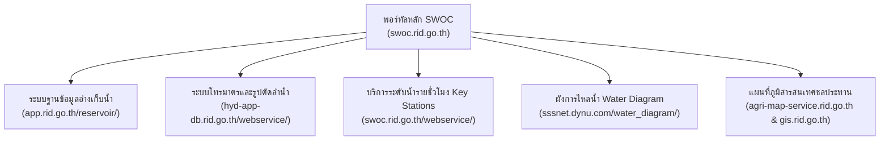

# คู่มือระบบฐานข้อมูลน้ำและโทรมาตร SWOC กรมชลประทาน (RID SWOC Guide & API Reference)

> บันทึกเมื่อ: **17 ตุลาคม 2569**  
> วัตถุประสงค์: บันทึกโครงสร้าง สถาปัตยกรรม บัญชี Endpoint และวิธีการดึงข้อมูลดิบจากศูนย์ปฏิบัติการน้ำอัจฉริยะ กรมชลประทาน (Smart Water Operation Center - SWOC) เพื่อใช้ในการศึกษาอุทกวิทยา การจำลองน้ำหลาก และการบริหารจัดการเขื่อน

---

## 1. ภาพรวมระบบและสถาปัตยกรรม (System Architecture)

หน้าพอร์ทัลหลักอยู่ที่ [swoc.rid.go.th](https://swoc.rid.go.th/) ซึ่งทำหน้าที่เป็น Web GIS Dashboard (Leaflet + Highcharts) รวมข้อมูลจากเซิร์ฟเวอร์ Backend หลักของกรมชลประทาน 4 แหล่ง:

### การพิสูจน์ตัวตน (Authentication & Access)
* **REST & WebService Endpoints**: **ไม่ต้องใช้ API Key หรือ Token ใด ๆ** สามารถยิง HTTP GET / POST (JSON) ได้โดยตรง
* **Header ที่แนะนำ**:
  * `User-Agent: Mozilla/5.0 ...`
  * `Referer: https://swoc.rid.go.th/`
* **Water Diagram**: มี Modal ป้องกันด้วยรหัสผ่านตัวเลขหน้าเว็บ รหัสผ่านคือ **`3939`** (พบในฟังก์ชัน `textGenerateLinkWater()` ในหน้าหลัก)

---

## 2. สารบัญ Endpoints ทั้งหมด (Comprehensive Endpoint Catalog)

### 2.1 กลุ่มระบบฐานข้อมูลอ่างเก็บน้ำ (`https://app.rid.go.th/reservoir/`)

#### 1) สถานะเขื่อนขนาดใหญ่ 35 แห่ง ณ ปัจจุบัน (GeoJSON)
* **Method**: `GET`
* **URL**: `https://app.rid.go.th/reservoir/api/damsGeojson`
* **พารามิเตอร์**: ไม่มี
* **สิ่งที่ได้**: ฟีเจอร์ GeoJSON จุดที่ตั้งเขื่อนขนาดใหญ่ 35 แห่งทั่วประเทศ พร้อมข้อมูลรายวันล่าสุด:
  * `max_capacity`: ความจุสูงสุด (ล้าน ลบ.ม.)
  * `active_storage`: ความจุเก็บกักปกติ (ล้าน ลบ.ม.)
  * `avalible_storage`: ความจุใช้การได้ (ล้าน ลบ.ม.)
  * `dead_storage`: ปริมาตรน้ำตาย (ล้าน ลบ.ม.)
  * `volume`: ปริมาตรน้ำปัจจุบัน (ล้าน ลบ.ม.)
  * `percent`: ร้อยละความจุ
  * `inflow`: ปริมาณน้ำไหลเข้า (ล้าน ลบ.ม./วัน)
  * `outflow`: ปริมาณน้ำระบาย (ล้าน ลบ.ม./วัน)
  * `date`: วันที่อัปเดต (`YYYY-MM-DD`)

#### 2) อนุกรมเวลาประวัติศาสตร์เขื่อนขนาดใหญ่รายวัน (Time Series)
* **Method**: `GET`
* **URL**: `https://app.rid.go.th/reservoir/api/dam`
* **พารามิเตอร์**:
  * `dam_id`: รหัสเขื่อน (เช่น `100501` ขุนด่านฯ, `100301` ป่าสักฯ, `200101` ภูมิพล, `200102` สิริกิติ์, `100107` แควน้อยฯ)
  * `date_start`: วันที่เริ่มต้น (`YYYY-MM-DD`)
  * `date_end`: วันที่สิ้นสุด (`YYYY-MM-DD`)
* **ความลึกของข้อมูล (Historical Depth)**: ย้อนหลังได้หลายสิบปี (เขื่อนภูมิพล/สิริกิติ์ ย้อนถึง 1995+, เขื่อนป่าสักฯ ย้อนถึง 2003, เขื่อนขุนด่านฯ ย้อนถึง 2005)
* **โครงสร้างข้อมูลสำคัญที่ส่งกลับ**:
  * `DMD_ULevel_curr`: ระดับน้ำในอ่าง (ม. รทก.)
  * `VAL_DMD_Q_curr`: ปริมาณน้ำใช้การได้ (ล้าน ลบ.ม.)
  * `DMD_QUse_curr`: ปริมาตรน้ำทั้งหมดในอ่าง (ล้าน ลบ.ม.)
  * `PERCENT_DMD_QUse_curr`: ร้อยละน้ำใช้การ
  * `DMD_Inflow_curr`: น้ำไหลเข้าประจำวัน (ล้าน ลบ.ม./วัน)
  * `DMD_Outflow_curr`: น้ำระบายประจำวัน (ล้าน ลบ.ม./วัน)
  * ฟิลด์เปรียบเทียบปีก่อนหน้า: `DMD_ULevel_prev`, `DMD_Inflow_prev`, `DMD_Outflow_prev`, `VAL_DMD_Q_prev`

#### 3) สถานะอ่างเก็บน้ำขนาดกลาง 461 แห่งทั่วประเทศ (GeoJSON)
* **Method**: `GET`
* **URL**: `https://app.rid.go.th/reservoir/api/rsvmiddlesGeojson`
* **พารามิเตอร์**:
  * `date_start`: วันที่ (`YYYY-MM-DD`)
  * `date_end`: วันที่ (`YYYY-MM-DD`)
* **สิ่งที่ได้**: GeoJSON ของอ่างเก็บน้ำขนาดกลาง 461 แห่ง ทุกภาค พร้อมชื่อ พิกัด จังหวัด (`cprov`), ภาค (`creg`), ปริมาตร (`qdisc`), น้ำเข้า (`q_info`), น้ำออก (`q_outfo`)

#### 4) อนุกรมเวลาอ่างเก็บน้ำขนาดกลางรายตัว (Time Series)
* **Method**: `GET`
* **URL**: `https://app.rid.go.th/reservoir/api/rsvmiddle`
* **พารามิเตอร์**:
  * `rsvmiddle`: รหัสอ่าง (เช่น `rsv380` ห้วยปรือ, `rsv383` ทรายทอง)
  * `date_start`: วันที่เริ่มต้น (`YYYY-MM-DD`)
  * `date_end`: วันที่สิ้นสุด (`YYYY-MM-DD`)
* **ความลึกของข้อมูล**: มีข้อมูลจริงตั้งแต่ปี **2009 เป็นต้นมา (18 ปี)**
* **สิ่งที่ได้**:
  * `cap_resv`: ความจุอ่าง (ล้าน ลบ.ม.)
  * `low_qdisc`: ปริมาตรน้ำก้นอ่าง / dead storage (ล้าน ลบ.ม.)
  * `qdisc_curr`: ปริมาตรน้ำปัจจุบัน (ล้าน ลบ.ม.)
  * `percent_resv_curr`: ร้อยละความจุ
  * `q_info`: ปริมาณน้ำเข้า (ล้าน ลบ.ม./วัน)
  * `q_outfo`: ปริมาณน้ำออก (ล้าน ลบ.ม./วัน)
  * `water_workable`: ปริมาณน้ำใช้การได้ (ล้าน ลบ.ม.)

#### 5) ทะเบียนจังหวัดและรายชื่ออ่างขนาดกลาง
* **ทะเบียนจังหวัด**: `GET https://app.rid.go.th/reservoir/api/province`
  * คืนรหัสจังหวัด เช่น `{"cprov": "22", "tprov": "นครนายก"}`
* **รายชื่ออ่างในจังหวัด**: `GET https://app.rid.go.th/reservoir/api/rsvmiddlename?cprov={cprov}`
  * คืนรายชื่ออ่างทั้งหมดในจังหวัดนั้น

#### 6) รายงานสรุปและการจัดกลุ่ม
* **สรุปเขื่อนใหญ่รายเดือน/รายปี**: `GET https://app.rid.go.th/reservoir/api/damreport?date_start={s}&date_end={e}&region={reg}`
* **สรุปเปอร์เซ็นต์น้ำเขื่อนใหญ่**: `GET https://app.rid.go.th/reservoir/api/summarypercentdam?date={date}&region={reg}`
* **สรุปอ่างขนาดกลางรายเดือน/ปี**: `GET https://app.rid.go.th/reservoir/api/reportrevmiddle?date_start={s}&date_end={e}&region={reg}&rid={rid}`
* **สรุปภาพรวมอ่างขนาดกลางทั้งประเทศ**: `GET https://app.rid.go.th/reservoir/api/summarymiddledam?date={date}`

---

### 2.2 กลุ่มบริการโทรมาตรและรูปตัดลำน้ำ (`https://hyd-app-db.rid.go.th/webservice/HDService.svc`)

บริการนี้เป็น WCF Service ที่สื่อสารผ่าน **HTTP POST (JSON)**:

#### 1) ข้อมูลพื้นฐานสถานีโทรมาตร (Station Metadata)
* **Method**: `POST`
* **URL**: `https://hyd-app-db.rid.go.th/webservice/HDService.svc/getStationFromStationCode`
* **Content-Type**: `application/json; charset=utf-8`
* **Payload**: `{"hydro": {"StationCode": "Ny.1B"}}` หรือ `{"hydro": {"StationCode": "C.2"}}`
* **สิ่งที่ได้**:
  * `stationid`: รหัสตัวเลขภายในของสถานี (ใช้ส่งต่อไปยัง API อื่น เช่น Ny.1B = `380`, C.2 = `315`)
  * `braelevel`: **ระดับตลิ่งทางการ (เมตร)** (Ny.1B = `8.81`, C.2 = `25.70 ม. รทก.`)
  * `QMax`: **ความจุลำน้ำสูงสุด (ลบ.ม./วินาที)** (Ny.1B = `266.90`, C.2 = `3,735`)
  * `ZG`: Zero Gauge / ค่าอ้างอิงความสูง
  * `UseMSLString`: ม.รทก. หรือ ม.รสม.
  * พิกัด `latitude`, `longitude`, ชื่อลำน้ำ, ลุ่มน้ำ, สำนักชลประทานที่รับผิดชอบ

#### 2) รูปตัดขวางลำน้ำจริง (River Cross-Sections)
* **Method**: `POST`
* **URL**: `https://hyd-app-db.rid.go.th/webservice/HDService.svc/GetCrosssectionFromStationID`
* **Content-Type**: `application/json; charset=utf-8`
* **Payload**: `{"hydro": {"StationID": 380}}` (ใช้ `stationid` จากข้อ 1)
* **สิ่งที่ได้**: อาร์เรย์ของจุดตัดขวางลำน้ำจริงจากการสำรวจของกรมชลประทาน:
  * `X`: ระยะห่างขวางลำน้ำ (Offset ในหน่วยเมตร จากซ้ายไปขวา)
  * `Y`: ระดับความสูงท้องน้ำ/ตลิ่ง (Elevation ในหน่วย ม. รทก.)

---

### 2.3 กลุ่มระดับน้ำรายชั่วโมง Key Stations (`https://swoc.rid.go.th/webservice/`)

#### ข้อมูลระดับน้ำและอัตราการไหลรายชั่วโมงล่าสุด
* **Method**: `POST`
* **URL**: `https://swoc.rid.go.th/webservice/keystation/KeyStationService.svc/GetHourlyStageFromStationCode`
* **Content-Type**: `application/json; charset=utf-8`
* **Payload**: `{"keyStation": {"StationCode": "NY.1B"}}`
* **สิ่งที่ได้**: อนุกรมเวลารายชั่วโมงล่าสุด:
  * `time`: เวลาในรูปแบบ `/Date(1792198800000+0700)/`
  * `values`: ระดับน้ำ (เมตร)
  * `qvalues`: อัตราการไหล $Q$ (ลบ.ม./วินาที)

---

### 2.4 กลุ่มประตูระบายน้ำหลัก (Floodgates / Telemetry)

* **Method**: `GET`
* **URL**: `https://app.rid.go.th/reservoir/telemetry/api/telemetryGeojson?basin=floodgate`
* **สิ่งที่ได้**: GeoJSON ของ 22 ปตร. หลัก (เช่น ปตร.ยางมณี, ปตร.มโนรมย์, ปตร.มหาราช) พร้อมระดับน้ำเหนือน้ำ (`TMD_UStream`, `TMD_ULevel`) และท้ายน้ำ (`TMD_DStream`)

---

## 3. ทะเบียนรหัสอ้างอิงที่สำคัญในระบบ

### อ่างเก็บน้ำใน จ.นครนายก (ลุ่มน้ำนครนายก / บางปะกง)
1. **เขื่อนขุนด่านปราการชล** (เขื่อนขนาดใหญ่): ID `100501` (ความจุ 224 ล้าน ลบ.ม.)
2. **อ่างเก็บน้ำห้วยปรือ**: ID `rsv380` (ความจุ 8.87 ล้าน ลบ.ม. - อ.เมือง)
3. **อ่างเก็บน้ำคลองสีเสียด**: ID `rsv381` (ความจุ 1.14 ล้าน ลบ.ม. - อ.เมือง)
4. **อ่างเก็บน้ำคลองโบด**: ID `rsv382` (ความจุ 4.25 ล้าน ลบ.ม. - อ.เมือง)
5. **อ่างเก็บน้ำทรายทอง**: ID `rsv383` (ความจุ 2.00 ล้าน ลบ.ม. - อ.เมือง)
6. **อ่างเก็บน้ำคลองวังบอน**: ID `rsv384` (ความจุ 7.60 ล้าน ลบ.ม. - อ.ปากพลี)
7. **อ่างเก็บน้ำคลองกลาง**: ID `rsv386` (ความจุ 3.10 ล้าน ลบ.ม. - อ.ปากพลี)

### เขื่อนขนาดใหญ่สำคัญในระบบลุ่มน้ำเจ้าพระยา / ป่าสัก
1. **เขื่อนป่าสักชลสิทธิ์**: ID `100301` (ความจุ 871.5 ล้าน ลบ.ม. / สูงสุด 1,036.16)
2. **เขื่อนแควน้อยบำรุงแดน**: ID `100107` (ความจุ 939 ล้าน ลบ.ม.)
3. **เขื่อนภูมิพล**: ID `200101` (ความจุ 13,462 ล้าน ลบ.ม.)
4. **เขื่อนสิริกิติ์**: ID `200102` (ความจุ 9,510 ล้าน ลบ.ม.)
5. **เขื่อนกระเสียว**: ID `100401` (ความจุ 299 ล้าน ลบ.ม.)
6. **เขื่อนคลองสียัด**: ID `100502` (ความจุ 420 ล้าน ลบ.ม.)
7. **เขื่อนนฤบดินทรจินดา**: ID `100514` (ความจุ 295 ล้าน ลบ.ม.)

---

## 4. โครงสร้างไฟล์ในคลังข้อมูลของโปรเจกต์ (`data/23_rid_swoc/`)

ข้อมูลที่ดึงจากระบบนี้ถูกจัดเก็บอย่างเป็นระบบที่:
- **`analysis/common_fetch_rid_swoc.py`**: สคริปต์กลางสำหรับดึง snapshot และอนุกรมเวลาย้อนหลัง
- **`data/23_rid_swoc/manifest.md`**: ทะเบียนกำกับแหล่งที่มา วันเวลา และรหัสแฮช SHA-256
- **`data/23_rid_swoc/_hashes.txt`**: เช็คซัมสำหรับ `verify_data_integrity.py`
- **`data/23_rid_swoc/raw/`**:
  - `dams_large_snapshot_latest.json`: สแนปช็อตเขื่อนใหญ่ 35 แห่ง
  - `dams_medium_snapshot_461.json`: สแนปช็อตอ่างขนาดกลาง 461 แห่ง
  - `nny_medium_dams_2026.json`: อนุกรมเวลา 6 อ่างนครนายก ช่วงน้ำท่วม 2569
  - `nny_medium_dams_history_2009_2026.json`: ประวัติย้อนหลังเต็ม (2009–2026) 6 อ่างนครนายก
  - `khundan_dam_history_2005_2026.json`: ประวัติย้อนหลังเต็ม (2005–2026) เขื่อนขุนด่านฯ
  - `pasak_dam_history_2003_2026.json`: ประวัติย้อนหลังเต็ม (2003–2026) เขื่อนป่าสักฯ
  - `kwainoi_dam_history_2009_2026.json`: ประวัติย้อนหลังเต็ม (2009–2026) เขื่อนแควน้อยฯ
  - `bhumibol_dam_history_1995_2026.json`: ประวัติย้อนหลังเต็ม (1995–2026) เขื่อนภูมิพล
  - `sirikit_dam_history_1995_2026.json`: ประวัติย้อนหลังเต็ม (1995–2026) เขื่อนสิริกิติ์
  - `rid_telemetry_cross_sections.json`: หน้าตัดลำน้ำจริงสถานี Ny.1B และ C.2
